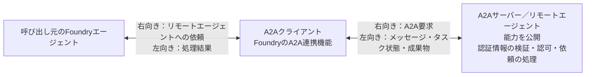
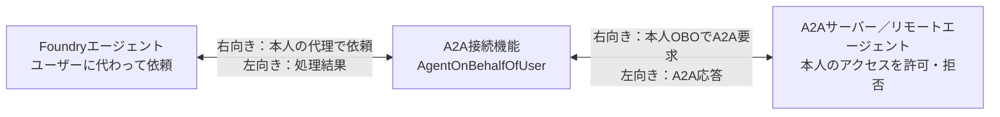
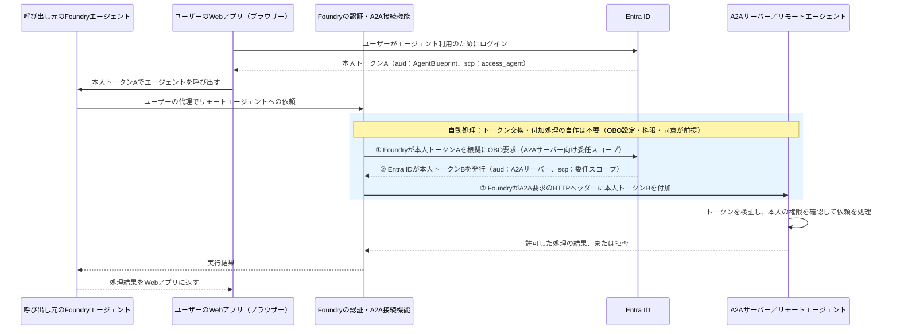
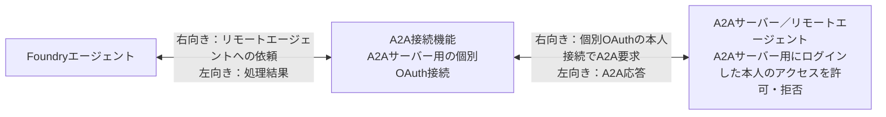
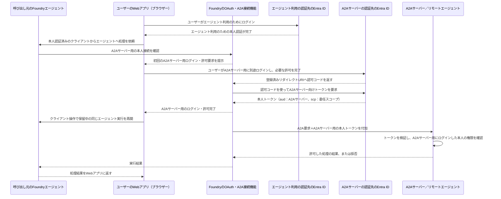
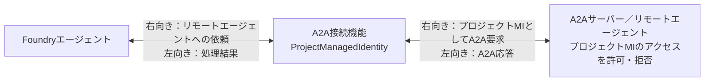
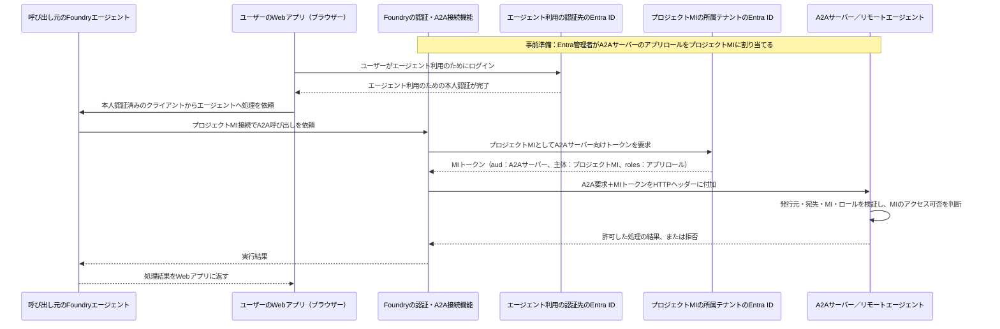
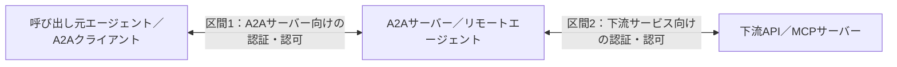

# A2Aの基本

このリポジトリの「A2A」列を読むための説明書。A2Aによるエージェント間通信、Foundryの接続設定、Entra認証、A2Aサーバー内部の認可、本人OBO・個別OAuth・アプリ認証を区別する。

**A2Aは通信プロトコルの名称。トークンを検証し、操作・データへのアクセス可否を判断する実体はA2Aサーバーである。** 本書の認証図は、今回検証したリモートA2AサーバーのEntra認証構成を示す。すべてのA2AサーバーがEntra認証を使うわけではない。

## 1. A2A・A2Aクライアント・A2Aサーバーの違い

| 用語 | 意味 | 担当すること |
| --- | --- | --- |
| A2A | Agent2Agent。エージェント間で依頼・結果をやり取りする通信プロトコル | 能力の公開、メッセージ、タスク、成果物などの形式を定める |
| A2Aクライアント | A2Aサーバーへ依頼を送る実装 | 接続先の情報確認、メッセージ送信、応答・タスク状態の受信 |
| A2Aサーバー | A2Aエンドポイントを公開するリモートエージェント／サービス | 認証情報の検証、認可、依頼の処理、結果の返却 |
| FoundryのA2Aツール・接続 | FoundryエージェントからリモートA2Aサーバーを利用する製品機能 | 接続先と認証方式を設定し、A2A要求を送る |
| Agent Card | A2Aサーバーが公開するメタデータ | エージェントの能力、スキル、接続先、認証要件などを説明する |

### イメージ図



- **呼び出し元のエージェント**がリモートエージェントに処理を依頼する。
- **A2Aクライアント**がA2Aサーバーと通信する。エージェントのモデルが通信・トークン操作を直接実装するわけではない。
- **A2Aサーバー**が依頼を処理し、応答や成果物を返す。呼び出し元へ内部のツールや実装を公開する必要はない。

MCPはツールの一覧取得・ツール実行を中心とする連携であり、A2Aはリモートエージェントへの依頼・結果の交換を行う連携である。A2Aを使うだけで、本人情報や認可が自動的に引き継がれるわけではない。

## 2. A2A呼び出しの流れ

```text
ユーザーが呼び出し元エージェントに処理を依頼
  -> 呼び出し元エージェントがA2A連携を選択
    -> A2A接続機能が接続先・Agent Card・認証要件を確認
      -> A2A接続機能がA2Aサーバー向けの認証情報を用意
        -> A2Aクライアントがメッセージを送信
          -> A2Aサーバーが認証情報を検証
            -> A2Aサーバーの認可ロジックが依頼の実行可否を判断
              -> リモートエージェントが依頼を処理
                -> 応答・タスク状態・成果物を呼び出し元に返す
```

Agent Cardの取得に認証を必要とする構成もある。Agent Card取得の可否と、依頼を実行する権限は別である。

A2A 0.3のJSON-RPCによるメッセージ送信本文の概念例：

```json
{
  "jsonrpc": "2.0",
  "id": 1,
  "method": "message/send",
  "params": {
    "message": {
      "kind": "message",
      "messageId": "<MESSAGE_ID>",
      "role": "user",
      "parts": [
        {
          "kind": "text",
          "text": "呼び出し元の本人情報を確認してください"
        }
      ]
    }
  }
}
```

`<MESSAGE_ID>` は説明用プレースホルダー。上記は初回メッセージの簡略例であり、接続・認証・タスク管理まで含む実行用コードではない。

**メッセージの `role: "user"` は発話の役割であり、本人認証の証拠ではない。** Entra認証を使う構成では、A2A接続機能がA2Aサーバー向けのトークンをHTTPヘッダーに付加する。トークンをメッセージ本文やモデルへのプロンプトに入れる方式ではない。

A2Aの応答はメッセージ、またはタスクになる。タスク受付・処理中と最終完了を区別する。本リポジトリの○は、受信だけでなく、呼び出し元の最終応答まで完了した結果である。

## 3. Agent Cardと接続設定は別

| 設定・情報 | 内容 | 設定・提供する担当 |
| --- | --- | --- |
| Agent Card | リモートエージェントの名前、能力、スキル、接続先、認証要件など | A2Aサーバーの開発者 |
| 接続先 | A2Aサーバーのエンドポイント | Foundry開発者 |
| 認証方式 | 本人OBO、個別OAuth、プロジェクトMIなど | Foundry開発者 |
| 委任スコープ／Audience | A2Aサーバーの認証用Entraアプリに対応する値 | A2Aサーバー側が定義し、Foundry開発者が接続に指定 |
| 操作・データへのアクセスルール | ユーザー／アプリごとに許可する依頼・データ | A2Aサーバーの開発者・管理者 |

**Agent Cardに認証方式やスキルを記載するだけで、認証・認可処理は実装されない。** Foundry側の接続設定、必要な同意・権限付与、受信側のトークン検証・認可が必要である。

## 4. Entra認証とA2Aサーバー側の認可

| 担当 | 役割 |
| --- | --- |
| Entra ID | ユーザーやアプリを認証し、A2Aサーバー向けのアクセストークンを発行する |
| A2Aサーバーの開発者・Entra管理者 | A2Aサーバー用Entraアプリを登録し、委任スコープ・アプリロールを定義する |
| ユーザーまたはEntra管理者 | エージェントによるユーザーの代理アクセスに必要な委任同意を付与する |
| Entra管理者 | A2Aサーバーのアプリロールを呼び出し元アプリ／プロジェクトMIに割り当てる |
| A2Aサーバーの認証処理 | トークンの署名・期限・発行元・宛先・呼び出し元を検証する |
| A2Aサーバーの認可ロジック | スコープ・ロール・内部のアクセスルールを使い、依頼・データへのアクセス可否を判断する |

**Entraアプリ登録とA2Aサーバーは、2つの別々のログイン先ではない。** Entra IDが発行したA2Aサーバー向けのトークンを、A2Aサーバーが検証する1つのアクセス区間である。

A2Aサーバーがユーザーのパスワードを検証するわけではない。A2Aサーバーの認証処理はEntra ID発行のトークンを検証する。A2Aプロトコル自体がEntra認証や業務データの認可ルールを定めるわけではない。

### トークンで確認する内容

- **発行元**：`iss`／`tid` が許可するEntraテナントに一致する。
- **宛先**：`aud` がA2Aサーバーの認証設定で期待する値に一致する。
- **本人／アプリ**：`oid` などで呼び出し元を確認する。必要に応じて代理呼び出し元のエージェント／クライアントも確認する。
- **委任権限**：本人OBO・個別OAuthでは `scp` を確認する。
- **アプリ権限**：本リポジトリのプロジェクトMI構成では `roles` を確認する。

トークンの内容を読み取るだけでは検証にならない。署名・期限などの検証と、依頼・データへの認可も必要である。

## 5. 本人OBO・個別OAuth・アプリ認証

| 方式 | A2Aサーバーへのアクセス | 今回のFoundry実機結果 |
| --- | --- | --- |
| 本人OBO | 呼び出し元エージェントがユーザーに代わってアクセスする | ○：T12・T14・T15・T17 |
| 個別OAuth | A2Aサーバーへのアクセス用にログインしたユーザーの接続を使う | ○：T10・T13・T18・T21 |
| アプリ認証 | プロジェクトMIとしてアクセスする | ○：T11 |

各図は、ユーザーがWebアプリから呼び出し元エージェントを利用する構成。「ユーザーのWebアプリ（ブラウザー）」の名称を統一し、エージェントを左、A2Aサーバーを右に配置する。

図は認証基盤・接続機能の役割を示す概念図。トークンをエージェントのモデルへ渡す実装手順ではない。接続機能がトークンの取得・付加とA2A通信を行う。

### 5-1. 本人OBO

#### イメージ図



#### Entraトークンを付加したイメージ図



トークンA・Bは説明用のラベル。**今回の本人OBO成功構成では、AもBも同じテナントの同じ本人ユーザーを表すが、宛先と委任スコープが異なる。** `access_agent` は今回のAgentBlueprint呼び出しに使用したスコープ。図の `aud：A2Aサーバー` は、A2Aサーバーの認証用Entraアプリに対応する宛先を意味する。

> **青色の範囲は、必要なOBO接続・権限設定・委任同意が済んでいれば自動で行われる。開発者がトークン交換・HTTPヘッダーへの付加処理を自作する必要はない。**
>
> **① OBO要求：Foundryの認証基盤／② 本人トークンBの発行：Entra ID／③ A2A要求へのトークン付加：FoundryのA2A接続機能。**
>
> **A2Aサーバー側のトークン検証・認可は、自動処理とは別に準備が必要。**

成立条件：

- **ユーザーがFoundryエージェントを利用するためにログインするテナントと、A2Aサーバーが受け入れる本人トークンの発行元テナントが同じである。**
- **Foundry開発者がAgentBlueprint方式の本人呼び出しと、A2Aサーバー向けの `AgentOnBehalfOfUser` 接続を設定する。**
- **Foundry開発者がBlueprintの委任権限を設定し、ユーザーまたは管理者が必要な委任同意を付与する。**
- **A2Aサーバーが本人トークンを検証し、本人のアクセスを許可する。**

エージェント向けの本人トークンをA2Aサーバーへ直接転送する方式ではない。`AgentOnBehalfOfUser` はプレビューであり、`UserEntraToken` の互換経路やプロジェクトMI接続とは区別する。

### 5-2. 個別OAuth

#### イメージ図



#### Entraトークンを付加したイメージ図



図は認可コード方式の初回フローを簡略化したもの。**エージェント利用のためのログインと、A2Aサーバー用の個別OAuthログインは別の認証である。エージェント向けの本人トークンをOBO交換する処理は行わない。** 2つのEntra IDの認証先は同じテナントの場合も、異なるテナントの場合もある。

成立条件：

- **Foundry開発者がA2Aサーバー向けのOAuth接続に、認可・トークンURL、クライアント、委任スコープなどを設定する。**
- **ユーザーがA2Aサーバーへのアクセス用に、A2Aサーバーの認証先テナントへ別途ログインする。**
- **ユーザーまたは管理者が必要な委任同意を付与する。**
- **A2AサーバーがA2Aサーバー用にログインした本人のトークンを検証し、本人のアクセスを許可する。**

ユーザーのログインと委任同意は別であり、管理者が事前同意済みの場合はユーザーの個別同意操作が不要になる場合がある。後続の実行で接続が再利用され、ログイン画面が表示されなくても、個別OAuthがOBOへ変わるわけではない。

### 5-3. アプリ認証（プロジェクトMI）

#### イメージ図



#### Entraトークンを付加したイメージ図



図は本リポジトリのアプリロールを使う構成であり、MIトークン取得の内部手順を簡略化している。**ユーザーのログインは呼び出し元エージェント利用のための認証であり、A2Aサーバー向けのMIトークン取得には本人トークンを使わない。**

成立条件：

- **Foundry開発者がA2Aサーバー向けのプロジェクトMI接続と、A2Aサーバーが期待するAudienceを設定する。**
- **Entra管理者がA2AサーバーのアプリロールをFoundryのプロジェクトMIに割り当てる。**
- **A2AサーバーがプロジェクトMIの所属テナント発行のMIトークンを検証し、プロジェクトMIのアクセスを許可する。**

A2Aサーバーへのアクセス主体はプロジェクトMIである。ユーザーのデータ権限をプロジェクトMIが自動的に引き継ぐわけではない。

## 6. FoundryのA2A接続設定

今回検証した接続propertiesの主な違い：

| 項目 | 本人OBO | 個別OAuth | プロジェクトMI |
| --- | --- | --- | --- |
| 接続の種類 | `category=RemoteA2A` | `category=RemoteA2A` | `category=RemoteA2A` |
| 接続先 | A2Aサーバーのエンドポイント | A2Aサーバーのエンドポイント | A2Aサーバーのエンドポイント |
| 認証方式 | `authType=AgentOnBehalfOfUser` | `authType=OAuth2` | `authType=ProjectManagedIdentity` |
| 宛先・権限の指定 | A2Aサーバーの完全修飾委任スコープ | OAuthの認可・トークンURL、クライアント、委任スコープなど | A2Aサーバーが期待する `audience` |
| 本人ログイン | エージェント利用のログインを根拠にOBO | A2Aサーバー用に別途ログイン | A2Aサーバー向けトークン取得にユーザーログインは使わない |

`audience` はトークンの宛先を識別する値。A2AサーバーのホストURLやFoundryプロジェクトURLと同じとは限らない。A2Aサーバー用Entraアプリと受信側の検証設定に整合する値を指定する。

Foundry開発者がA2Aツールに接続を関連付ける。MCP用の `RemoteTool` 接続をA2A用の `RemoteA2A` 接続として扱わない。

### ツールとプロトコルのバージョン

**本リポジトリの実機検証は `a2a_preview` ツールとA2A 0.3系の専用identity agentを使用した。** 公式資料は新しい `a2a` ツール（A2A 1.0、GA）と、既存の `a2a_preview` ツール（A2A 0.3、プレビュー）を分けている。

本書の○を、A2A 1.0の新しいツール、すべてのFoundry間連携、すべてのチャネルで確認済みとは扱わない。A2Aツールの提供状態と、本人OBO認証方式のプレビュー状態も別々に確認する。

[本人OBOの設定例](../examples/foundry-a2a-obo.connection.json)・[個別OAuthの設定例](../examples/foundry-a2a-oauth.connection.json)は匿名化した概念テンプレート。使用するAPIバージョン・SDK・ツールの仕様は公式資料で確認する。

## 7. Copilot StudioのA2A連携

**本リポジトリではCopilot StudioからのA2A連携を未検証。** Foundryの成功例をCopilot Studioへ流用せず、未検証を製品非サポートとも扱わない。

利用者準備が必要になった場合は、環境のアクセス用セキュリティグループ所属とDataverseの環境ユーザー登録・有効状態を独立して確認する。[利用者準備の前提](認証方式と成立条件.md)を参照。

## 8. マルチテナントと下流サービス

### 配置先・アプリ登録先・発行元を分ける

- **配置先**：A2Aサーバーをどのテナントのリソースで稼働させるか。
- **アプリ登録先**：A2Aサーバー用Entraアプリをどのテナントで登録したか。
- **トークン発行元**：A2Aサーバーがどのテナント発行の本人／MIトークンを受け入れるか。

**T17では、Foundryエージェントの本人ログイン先はH、A2Aサーバーの配置先はR、A2Aサーバーが受け入れた本人トークンの発行元はHである。** 本人の認証先は同じテナントであり、別テナントの本人へOBOで切り替えた結果ではない。

MCPのD17も同じ認証境界で成立した。**MCPのD09-M・D20-Mに相当する、A2Aサーバー用Entraアプリをマルチテナント化する追加構成は未検証。** MCPとA2Aの製品対応差が確定したわけではない。

### リモートエージェントが別のAPI・MCPを呼ぶ場合



**A2Aサーバーへの本人OBO成功は、リモートエージェントから下流API・MCPへの本人OBO成功を意味しない。** A2Aサーバー用のトークンを、宛先が異なる下流サービスへそのまま転送しない。リモートエージェントの開発者が下流サービス向けの認証・認可を別途設計する。

## 9. 本リポジトリの検証範囲

| 対象 | 判定・根拠 |
| --- | --- |
| Foundryの本人OBO | ○：T12・T14・T15・T17 |
| Foundryの個別OAuth | ○：T10・T13・T18・T21 |
| FoundryのプロジェクトMI | ○：T11。R側プロジェクトMIを確認 |
| 本人OBOの実行不成立 | ×：T07・T09・T20・T22。SendMessageタイムアウト。本人受信は未確認 |
| 反対テナントの単一テナント認証先へのプロジェクトMI | ×：T19。ARA BadRequestでトークン取得に失敗。MI受信は未確認 |
| 匿名の負対照 | —：T08・T16。保護されたA2Aが401で拒否。本人OBOの試験ではない |
| A2Aサーバー用Entraアプリのマルチテナント追加構成 | 未検証 |
| Copilot StudioからのA2A | 未検証 |

○は、Foundryのnative A2A出力、期待する本人／アプリと権限、同じ実行の受信側生成receiptとログ、呼び出し元の最終応答完了を照合した結果。Agent Card取得、HTTP 200、OAuth同意画面、エージェントの回答文章だけでは成功と判断しない。

タイムアウトを製品非サポートと断定しない。認証・受信の成功と、モデル処理・最終応答の成功も区別する。

元のSharePoint行をA2Aへ置換した試験は、SharePoint文書取得・ライセンス・業務データの認可を検証した結果ではない。専用identity agentの結果を、すべてのリモートエージェントの互換性や業務データの認可へ拡張しない。

## 参照

- [Foundry A2Aツールの公式資料](https://learn.microsoft.com/en-us/azure/foundry/agents/how-to/tools/agent-to-agent)（確認：2026-11-09）
- [Foundry A2A認証の公式資料](https://learn.microsoft.com/en-us/azure/foundry/agents/concepts/agent-to-agent-authentication)
- [A2A 0.3のプロトコル仕様](https://a2a-protocol.org/v0.3.0/specification/)（プロトコルの説明。実機の全仕様への準拠証明ではない）
- [API：HTTP／OpenAPIの基本](API_HTTP_OpenAPIの基本.md)
- [MCPの基本](MCPの基本.md)
- [認証方式と成立条件](認証方式と成立条件.md)
- [A2A認証マトリクス](A2A認証マトリクス.md)
- [検証方法と限界](検証方法と限界.md)
