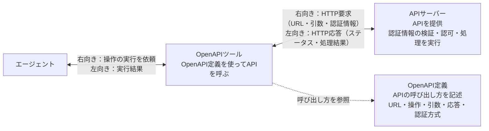
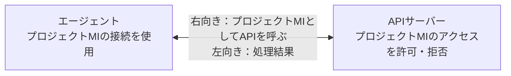
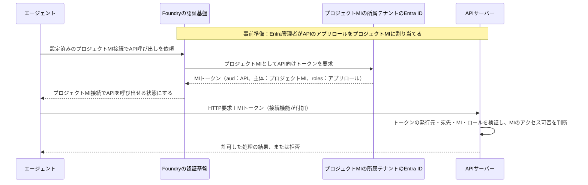

# API：HTTP／OpenAPIの基本

このリポジトリの「API：HTTP／OpenAPI」列を読むための説明書。HTTPによるAPI呼び出し、OpenAPI定義、ユーザー認証、OBO、アプリ認証、API側の認可を区別する。

**HTTPやOpenAPI自体の機能と、Foundry／Copilot Studioが提供する接続機能は別である。** HTTPで実装できる認証方式が、製品の標準ツールでも利用できるとは限らない。

## 1. API・HTTP・OpenAPIの違い

| 用語 | 意味 | 例 |
| --- | --- | --- |
| API | 外部から操作・情報取得を行うためのインターフェース | 本人情報取得、注文参照 |
| HTTP | クライアントとAPIサーバーが要求・応答をやり取りする通信方式 | `GET`、`POST`、ステータスコード、ヘッダー、本文 |
| OpenAPI | HTTP APIの呼び出し方を記述する仕様 | URL、パス、操作、引数、応答、認証方式の定義 |
| OpenAPIツール | OpenAPI定義を使ってエージェントからAPIを呼ぶ製品機能 | Foundryの標準OpenAPIツール |

### イメージ図



- **API**は、APIサーバーが外部へ提供する操作・情報取得の窓口。
- **HTTP**は、OpenAPIツールとAPIサーバーが要求・応答をやり取りする通信方式。
- **OpenAPI定義**は呼び出し方の説明であり、通信を中継するサーバーではない。図の点線は設定の参照、実線は実行時のやり取りを示す。

**OpenAPI定義はAPIサーバーの実装ではない。** OpenAPI定義を書くだけでは、APIサーバー、ユーザーログイン、トークン発行、アクセス制御は作成されない。

MCPサーバーやA2AサーバーもHTTPを使う構成がある。ただし、このリポジトリではエージェントからの接続方式を区別し、MCP／A2Aの成功を標準OpenAPIの成功には流用しない。

## 2. HTTP API呼び出しの流れ

```text
クライアント／エージェント
  -> APIのURLにHTTP要求を送信
    -> APIサーバーが要求を受信
      -> APIサーバーが認証情報を検証
        -> APIサーバーの認可ロジックが操作・データへのアクセス可否を判断
          -> APIサーバーが処理結果をHTTP応答で返す
```

Entra認証を使う概念例：

```http
GET /identity HTTP/1.1
Host: api.example.invalid
Authorization: Bearer <ACCESS_TOKEN>
Accept: application/json
```

- **クライアント／エージェント**がAPI向けのアクセストークンをHTTPヘッダーに設定する。
- **APIサーバー**がアクセストークンを検証する。
- **APIサーバーの認可ロジック**が呼び出し元に許可された操作を実行する。

`<ACCESS_TOKEN>` は説明用のプレースホルダー。実際のトークンをOpenAPI定義、ソースコード、公開資料に保存しない。

## 3. OpenAPI定義で記述する内容

| 項目 | 記述する内容 |
| --- | --- |
| `servers` | APIの接続先URL |
| `paths` | `/identity` などのパスとHTTPメソッド |
| `operationId` | ツールが識別する操作名 |
| `parameters`／`requestBody` | 引数・要求本文の形式 |
| `responses` | 応答の形式 |
| `components.securitySchemes`／`security` | APIが要求する認証方式と適用対象 |

**OpenAPI定義の認証方式の記述と、Foundryの認証用接続設定は別である。** APIキーの保管やMIトークンの取得には製品側の接続設定が必要になる。OpenAPI定義にOAuthを記述しても、Foundry標準OpenAPIツールに本人OBO機能が追加されるわけではない。

## 4. Entra認証とAPI側の認可

| 担当 | 役割 |
| --- | --- |
| Entra ID | ユーザーやアプリを認証し、API向けのアクセストークンを発行する |
| API開発者・Entra管理者 | API用のEntraアプリを登録し、委任スコープ・アプリロールを定義する |
| ユーザーまたはEntra管理者 | ユーザーの代理アクセスに必要な委任同意を付与する |
| Entra管理者 | APIのアプリロールを呼び出し元アプリ／MIに割り当てる |
| APIサーバーの認証処理 | トークンの署名・期限・発行元・宛先・呼び出し元を検証する |
| APIサーバーの認可ロジック | スコープ・ロール・内部のアクセスルールを使い、操作・データへのアクセス可否を判断する |

**Entraアプリ登録でスコープやロールを定義することと、APIが業務データへのアクセスを許可することは別である。** API開発者がAPI側の認可ロジックを実装する。認証基盤や認可ミドルウェアを利用する構成もある。

### トークンの発行元と宛先

- `iss`／`tid`：トークンを発行したEntraテナントを確認する。
- `aud`（audience）：トークンがどのAPI向けに発行されたかを確認する。APIが期待する宛先の値と照合する。
- `oid`：テナント内のユーザー／サービスプリンシパルを識別する。
- `scp`：本人委任のスコープを確認する。
- `roles`：アプリ認証で使用するアプリロールなどを確認する。APIの発行・認可仕様に従って扱う。

`audience` はAPIのホストURLやFoundryプロジェクトのURLと同じとは限らない。API用EntraアプリとAPI側の検証設定に整合する値を指定する。

## 5. 本人OBO・個別OAuth・アプリ認証

| 方式 | APIへのアクセス主体 | トークン取得の考え方 |
| --- | --- | --- |
| 本人OBO | ユーザーに代わって呼び出すエージェント／クライアント | エージェント向けの本人トークンを根拠に、認証基盤がEntra IDへAPI向けトークンを要求する |
| 個別OAuth | APIへのアクセス用にログインしたユーザー | ユーザーがAPIの認証先に別途ログインし、下流用のOAuthセッションを確立する |
| アプリ認証 | プロジェクトMI／アプリ | ユーザーの委任トークンではなく、アプリとしてAPI向けトークンを取得する |

### 5-1. 本人OBO

**Foundry標準OpenAPIツールは本人OBO非サポート。図と実行フローの説明は省略する。** MCP／A2Aの本人OBOは[認証方式と成立条件](認証方式と成立条件.md)を参照。

### 5-2. 個別OAuth

**Foundry標準OpenAPIツールは、ユーザーがAPI用に別途ログインする個別OAuth方式を非サポート。図と実行フローの説明は省略する。** 事前保存したBearerトークンを使用する方式とは区別する。MCP／A2Aの個別OAuthは[認証方式と成立条件](認証方式と成立条件.md)を参照。

### 5-3. アプリ認証（プロジェクトMI）

エージェントがプロジェクトMIのAPI向けトークンを使ってAPIを呼び出す。APIへのアクセス主体はユーザーではなく、プロジェクトMIである。

#### イメージ図



#### Entraトークンを付加したイメージ図



図は本リポジトリのアプリロールを使用するAPIの構成。ユーザーの委任同意ではなく、プロジェクトMIへの権限付与が必要。MIトークンの取得を簡略化しており、エージェントに秘密やトークンを直接保持させる実装手順ではない。

アプリ認証では、ユーザーがエージェントにログインしていても、APIへのアクセス主体はMI／アプリである。ユーザーのデータ権限をMIが自動的に引き継ぐわけではない。

## 6. Foundry標準OpenAPIツール

### 利用できる認証方式

公式資料の認証選択肢は、匿名、APIキー／事前保存トークン、プロジェクトMI。

| 方式 | Foundry開発者が設定する内容 | 注意 |
| --- | --- | --- |
| 匿名 | 匿名用のOpenAPIプロジェクト接続とOpenAPI定義 | 匿名でもプロジェクト接続が必要。匿名401は本人OBOの試験ではない |
| APIキー／事前保存トークン | 資格情報を保管するプロジェクト接続と、APIが要求するヘッダー等 | 事前保存トークンは実行ユーザーの本人OBOではない |
| プロジェクトMI | `authType=ProjectManagedIdentity`、APIのTarget URL、APIが期待するAudience、OpenAPI定義、使用する接続 | プロジェクトMIへの権限付与が必要 |

**Foundryの標準OpenAPIツールは本人OBO非サポート。** HTTP APIそのものがOBO非対応という意味ではない。今回のFoundry本人OBOの成功例はMCP／A2A接続であり、標準OpenAPIの成功例ではない。

### プロジェクトMIの設定と実行

1. **API開発者・Entra管理者**がAPI用Entraアプリとアプリロールを用意する。
2. **Entra管理者**が必要なAPIアプリロールをFoundryのプロジェクトMIに割り当てる。
3. **Foundry開発者**がOpenAPIプロジェクト接続にAPIのTarget URL、期待するAudience、プロジェクトMI認証を設定する。
4. **Foundry開発者**がOpenAPIツールにOpenAPI定義と使用する接続を指定し、エージェントから利用できるようにする。
5. **Foundryの認証基盤**がプロジェクトMIのAPI向けトークンを取得し、OpenAPIツールがAPIを呼び出す。
6. **APIサーバー**がMIトークンを検証し、APIサーバーの認可ロジックがプロジェクトMIのアクセス可否を判断する。

APIがAzure RBACなど別の認可方式を使う場合は、APIに適した権限付与が必要。本リポジトリの疑似APIではEntraアプリロールを使用した。

プロジェクトMIとFoundryアカウントのMIは別のID。別のMIへのロール割当で、プロジェクトMIの権限付与を代用しない。

### MCP／A2A接続との設定の違い

| 設定 | OpenAPI | MCP | A2A |
| --- | --- | --- | --- |
| 呼び出し方法 | OpenAPI定義でAPIの操作・引数・応答を記述 | MCPツールにMCPサーバーの接続を指定 | A2AツールにA2Aサーバーの接続を指定 |
| 接続先 | APIのTarget URL | MCPエンドポイント | A2Aエンドポイント |
| MIの指定 | OpenAPIプロジェクト接続でプロジェクトMIとAudienceを指定 | `RemoteTool` 接続で `ProjectManagedIdentity` と `audience` を指定 | `RemoteA2A` 接続で `ProjectManagedIdentity` と `audience` を指定 |
| 共通する受信側の条件 | APIがMIを検証・認可 | MCPサーバーがMIを検証・認可 | A2AサーバーがMIを検証・認可 |

**違うのは製品側のツール・接続設定と通信手順。MIの発行元・宛先・主体・権限を検証し、アクセスを許可する基本条件は共通である。** APIバージョンやツール構成によって設定形式が変わるため、公式資料と使用するSDKの仕様を確認する。

## 7. Copilot StudioのHTTP API連携

- **カスタムコネクタの本人OBO／SSO**：ユーザーの代理アクセスとしてHTTP APIを呼ぶ構成。Foundry標準OpenAPIの認証制限をCopilot Studioへ適用しない。
- **エージェントフローのHTTP呼び出し・アプリ認証**：アプリ資格情報などを使う別構成。カスタムコネクタの本人OBOと区別する。

新しい利用者の準備では、環境のアクセス用セキュリティグループ所属と、Dataverseの環境ユーザー登録・有効状態を別々に確認する。エージェントとカスタムコネクタの利用権限も別々に確認する。詳しくは[利用者追加の前提](認証方式と成立条件.md)を参照。

## 8. マルチテナントで混同しないこと

| 項目 | 確認する内容 |
| --- | --- |
| ユーザーログイン | ユーザーがエージェント利用のためにログインしたテナント。Guestの場合はGuestとしてログインしたテナント |
| APIの配置先 | APIサーバーを稼働させるAzureリソース等のテナント |
| APIのアプリ登録先 | API用Entraアプリを登録したテナント |
| トークン発行元 | APIが受け入れるトークンを発行したテナント |
| API側の認可 | APIが許可するユーザー／アプリ、操作、データ |

**APIの配置先が別テナントでも、APIが呼び出し元テナント発行のトークンを受け入れる構成は成立し得る。** APIの配置先が異なることと、別テナント発行のトークンを取得することは別である。

API用Entraアプリのマルチテナント化だけでは成立を保証しない。呼び出し元テナントのサービスプリンシパル、必要な権限付与・同意、APIの発行元検証・認可を確認する。

## 9. 本リポジトリの検証範囲

| 対象 | 判定・根拠 |
| --- | --- |
| Foundry標準OpenAPIの本人OBO | **非サポート（仕様）**：D08・D16 |
| Foundry標準OpenAPIのプロジェクトMI | **○**：A07・A10。A10はリクエスト単位のAPI認証ログ照合が未実施 |
| Copilot StudioのカスタムコネクタOBO／SSO | **○**：D03。3名の本人情報取得を確認。業務データの認可は未検証 |
| Copilot StudioのフローHTTP・アプリ認証 | **未検証**：A01〜A04 |
| MCP／A2Aでの本人OBO・個別OAuth | 接続方式が異なるため、HTTP／標準OpenAPI列の成功には含めない |

HTTP 200、エージェントの回答文章、接続設定の保存だけでは認証・認可成功と判断しない。APIの実出力、期待する本人／アプリ、受信側の検証結果を確認する。401は一般に認証情報の不足・不正、403は一般にアクセス拒否を示すが、エラー本文と発生箇所も確認する。タイムアウトを製品非対応と断定しない。

認証基盤の動作確認と、業務データへの許可・拒否の確認は別である。詳しくは[検証方法と限界](検証方法と限界.md)を参照。

## 参照

- [Foundry OpenAPIツールの公式資料](https://learn.microsoft.com/en-us/azure/foundry/agents/how-to/tools/openapi)（仕様確認：2026-11-09）
- [構成・用語](構成と用語.md)
- [認証方式ごとの成立条件](認証方式と成立条件.md)
- [本人委任・API／MCPマトリクス](本人委任_API_MCPマトリクス.md)
- [アプリ認証マトリクス](アプリ認証マトリクス.md)
- [A2Aマトリクス](A2A認証マトリクス.md)
