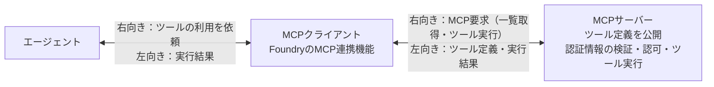
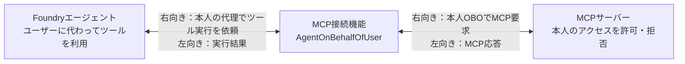
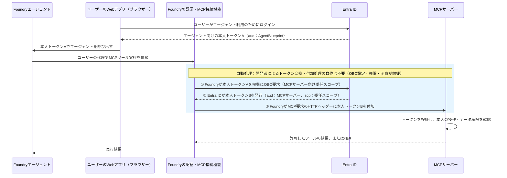
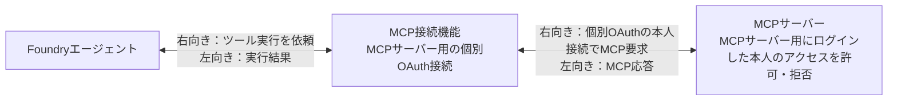
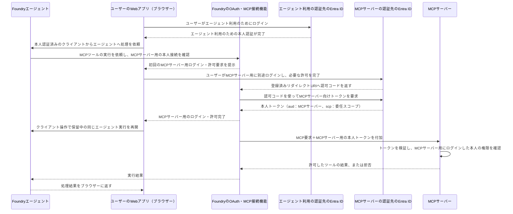
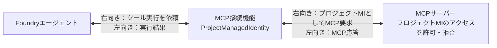
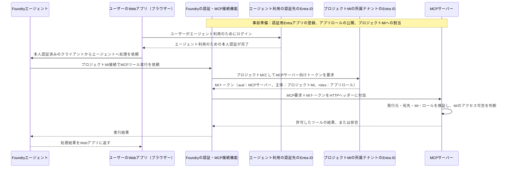
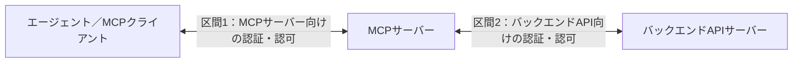

# MCPの基本

このリポジトリの「MCP」列を読むための説明書。MCPの通信、Foundryの接続設定、Entra認証、MCPサーバー内部の認可、本人OBO・個別OAuth・アプリ認証を区別する。

**MCPは通信プロトコルの名称。トークンを検証し、操作・データへのアクセス可否を判断する実体はMCPサーバーである。** 本書の認証図は、今回検証したリモートMCPサーバーのEntra認証構成を示す。すべてのMCPサーバーがEntra認証を使うわけではない。

## 1. MCP・MCPクライアント・MCPサーバーの違い

| 用語 | 意味 | 担当すること |
| --- | --- | --- |
| MCP | Model Context Protocol。ツールやコンテキストをアプリケーションへ提供する通信プロトコル | ツールの一覧取得・実行要求・結果の形式などを定める |
| MCPクライアント | MCPサーバーと通信する実装 | 初期化、ツール一覧取得、ツール実行、結果の受信 |
| MCPサーバー | ツールを公開し、実行するサービス | ツール定義の提供、認証情報の検証、認可、処理 |
| FoundryのMCPツール・接続 | FoundryエージェントからリモートMCPサーバーを利用する製品機能 | 接続先、使用する認証方式、公開ツールの利用を設定する |
| MCPツール定義 | MCPサーバーが返す操作の説明 | ツール名、説明、引数のスキーマなどを提供する |

### イメージ図



- **エージェント**が利用するツールを選び、実行を依頼する。
- **MCPクライアント**がMCPサーバーと通信する。エージェントのモデルが通信・トークン操作を直接実装するわけではない。
- **MCPサーバー**が操作の呼び出し方をツール定義として返す。Foundry標準OpenAPIツールのようにOpenAPI定義を登録する方式とは異なる。

MCPにはツール以外にリソースやプロンプトを提供する機能もある。本リポジトリの検証対象は、FoundryからのリモートMCPツール呼び出しである。

## 2. MCPツール呼び出しの流れ

```text
エージェント
  -> MCPクライアントがMCPサーバーとの通信を初期化
    -> MCPクライアントがツール一覧を取得（tools/list）
      -> エージェントがツールと引数を選択
        -> MCPクライアントがツール実行を要求（tools/call）
          -> MCPサーバーが認証情報を検証
            -> MCPサーバーの認可ロジックが操作・データへのアクセス可否を判断
              -> MCPサーバーがツールを実行して結果を返す
```

保護されたMCPサーバーでは、初期化やツール一覧取得の段階でも認証が必要になる。ツール実行時だけ認証すればよいとは限らない。

ツール実行要求の本文の概念例：

```json
{
  "jsonrpc": "2.0",
  "id": 1,
  "method": "tools/call",
  "params": {
    "name": "get_identity",
    "arguments": {}
  }
}
```

`get_identity` は説明用のツール名。実際のツール名・引数はMCPサーバーが公開する定義に従う。

Entra認証を使うHTTP接続では、**MCP接続機能がMCPサーバー向けのアクセストークンをHTTPのAuthorizationヘッダーに付加する。** トークンをツール引数やモデルへのプロンプトに渡す方式ではない。

## 3. ツール定義と接続設定は別

| 設定 | 内容 | 設定・提供する担当 |
| --- | --- | --- |
| ツール定義 | ツール名、説明、入力スキーマなど | MCPサーバーの開発者 |
| 接続先 | リモートMCPサーバーのエンドポイント | Foundry開発者 |
| 認証方式 | 本人OBO、個別OAuth、プロジェクトMIなど | Foundry開発者 |
| 委任スコープ／Audience | MCPサーバーの認証用Entraアプリに対応する値 | MCPサーバー側が定義し、Foundry開発者が接続に指定 |
| 操作・データへのアクセスルール | ユーザー／アプリごとに許可する操作・データ | MCPサーバーの開発者・管理者 |

**ツール一覧に表示されることと、ツールの実行権限があることは別である。** エージェント側のツール実行承認も、Entraの委任同意やMCPサーバー内部の認可とは別の確認である。

## 4. Entra認証とMCPサーバー側の認可

| 担当 | 役割 |
| --- | --- |
| Entra ID | ユーザーやアプリを認証し、MCPサーバー向けのアクセストークンを発行する |
| MCPサーバーの開発者・Entra管理者 | MCPサーバー用のEntraアプリを登録し、委任スコープ・アプリロールを定義する |
| ユーザーまたはEntra管理者 | エージェントによるユーザーの代理アクセスに必要な委任同意を付与する |
| Entra管理者 | MCPサーバーのアプリロールを呼び出し元アプリ／プロジェクトMIに割り当てる |
| MCPサーバーの認証処理 | トークンの署名・期限・発行元・宛先・呼び出し元を検証する |
| MCPサーバーの認可ロジック | スコープ・ロール・内部のアクセスルールを使い、操作・データへのアクセス可否を判断する |

**Entraアプリ登録とMCPサーバーは、2つの別々のログイン先ではない。** Entra IDが発行したMCPサーバー向けのトークンを、MCPサーバーが検証する1つのアクセス区間である。

MCPサーバーがユーザーのパスワードを検証するわけではない。MCPサーバーの認証処理はEntra ID発行のトークンを検証する。スコープやアプリロールの定義だけで、業務データへのアクセス制御が実装されるわけではない。

### トークンで確認する内容

- **発行元**：`iss`／`tid` が許可するEntraテナントに一致する。
- **宛先**：`aud` がMCPサーバーの認証設定で期待する値に一致する。
- **本人／アプリ**：`oid` などで呼び出し元を確認する。必要に応じて代理呼び出し元のエージェント／クライアントも確認する。
- **委任権限**：本人OBO・個別OAuthでは `scp` を確認する。
- **アプリ権限**：本リポジトリのプロジェクトMI構成では `roles` を確認する。

トークンの内容を読み取るだけでは検証にならない。署名・期限などの検証と、操作・データへの認可も必要である。

## 5. 本人OBO・個別OAuth・アプリ認証

| 方式 | MCPサーバーへのアクセス | 今回のFoundry実機結果 |
| --- | --- | --- |
| 本人OBO | エージェントがユーザーに代わってアクセスする | ○：D12・D17、条件変更後D09-M・D20-M |
| 個別OAuth | MCPサーバーへのアクセス用にログインしたユーザーの接続を使う | ○：D10・D13・D18・D21 |
| アプリ認証 | プロジェクトMIとしてアクセスする | ○：A07・A10 |

図は認証基盤・接続機能の役割を示す概念図。トークンをエージェントのモデルへ渡す実装手順ではない。接続機能がトークンの取得・付加とMCP通信を行う。

### 5-1. 本人OBO

#### イメージ図



#### Entraトークンを付加したイメージ図



トークンA・Bは説明用のラベル。OBOでは、Entra IDがエージェント向けの本人トークンを根拠に、宛先が異なるMCPサーバー向けの本人トークンを発行する。エージェント向けの本人トークンをMCPサーバーへ直接転送する方式ではない。

> **青色の範囲は、必要なOBO接続・権限設定・委任同意が済んでいれば自動で行われる。開発者がトークン交換・HTTPヘッダーへの付加処理を自作する必要はない。**
>
> **① OBO要求：Foundryの認証基盤／② 本人トークンBの発行：Entra ID／③ MCP要求へのトークン付加：FoundryのMCP接続機能。**
>
> **MCPサーバー側のトークン検証・認可は、自動処理とは別に準備が必要。**

成立条件：

- **MCPサーバーの開発者・Entra管理者がMCPサーバーの認証先テナントに認証用Entraアプリを登録し、委任スコープを公開する。D12・D17ではシングルテナント登録を使用した。**
- **ユーザーがFoundryエージェントを利用するためにログインするテナントと、MCPサーバーの認証先テナントが同じである。**
- **Foundry開発者がAgentBlueprint方式の本人呼び出しと、MCPサーバー向けの `AgentOnBehalfOfUser` 接続を設定する。**
- **Foundry開発者がBlueprintの委任権限を設定し、ユーザーまたは管理者が必要な委任同意を付与する。**
- **MCPサーバーが本人トークンを検証し、本人のアクセスを許可する。**

`AgentOnBehalfOfUser` はプレビュー。FoundryのエージェントリソースID、EntraのAgent Identity、プロジェクトMIは別の識別子。本人OBOではエージェントがユーザーを代理するため、プロジェクトMIだけのアクセスと区別する。

### 5-2. 個別OAuth

#### イメージ図



#### Entraトークンを付加したイメージ図



図はエージェント利用のためのログインから始まる、認可コード方式の初回フローを簡略化したもの。**エージェント利用のためのログインと、MCPサーバー用の個別OAuthログインは別の認証である。エージェント向けの本人トークンをOBO交換する処理は行わない。** 2つのEntra IDの認証先は同じテナントの場合も、異なるテナントの場合もある。ユーザーのログインと委任同意は別であり、管理者が事前同意済みの場合はユーザーの個別同意操作が不要になる場合がある。

成立条件：

- **Foundry開発者がMCPサーバー向けのOAuth接続に、認可・トークンURL、クライアント、委任スコープなどを設定する。**
- **MCPサーバーの開発者・Entra管理者がMCPサーバーの認証先テナントに認証用Entraアプリをシングルテナント登録し、委任スコープを公開する（今回の検証構成）。**
- **Foundry開発者・Entra管理者がOAuthクライアントアプリを登録し、リダイレクトURIと必要な委任権限を設定する。**
- **ユーザーがMCPサーバーへのアクセス用に、MCPサーバーの認証先テナントへ別途ログインする。**
- **ユーザーまたは管理者が必要な委任同意を付与する。**
- **MCPサーバーがMCPサーバー用にログインした本人のトークンを検証し、本人のアクセスを許可する。**

ユーザーがエージェント利用のためにログインするテナントと、MCPサーバー用にログインするテナントが異なる場合も成立した。Guestとしてログインした場合はGuest本人のアクセスとなる。

後続の実行で本人の接続が再利用され、ログイン画面が表示されなくても、個別OAuthがOBOへ変わるわけではない。

### 5-3. アプリ認証（プロジェクトMI）

#### イメージ図



#### Entraトークンを付加したイメージ図



図は5-1・5-2と同じく、ユーザーがWebアプリからエージェントを利用する構成。**ユーザーのログインはエージェント利用のための認証であり、MCPサーバー向けのMIトークン取得には本人トークンを使わない。** 本リポジトリのアプリロールを使う構成であり、MIトークン取得の内部手順を簡略化している。

成立条件：

- **Foundry開発者がMCPサーバー向けのプロジェクトMI接続と、MCPサーバーが期待するAudienceを設定する。**
- **MCPサーバーの開発者・Entra管理者がプロジェクトMIと同じ認証先テナントに認証用Entraアプリをシングルテナント登録し、アプリロールを公開する（今回の検証構成）。**
- **Entra管理者がMCPサーバーのアプリロールをFoundryのプロジェクトMIに割り当てる。**
- **MCPサーバーがプロジェクトMIの所属テナント発行のMIトークンを検証し、プロジェクトMIのアクセスを許可する。**

ユーザーがエージェントにログインしていても、MCPサーバーへのアクセス主体はプロジェクトMIである。ユーザーのデータ権限をプロジェクトMIが自動的に引き継ぐわけではない。

## 6. FoundryのMCP接続設定

今回検証した接続propertiesの主な違い：

| 項目 | 本人OBO | 個別OAuth | プロジェクトMI |
| --- | --- | --- | --- |
| 接続の種類 | `category=RemoteTool` | `category=RemoteTool` | `category=RemoteTool` |
| 接続先 | MCPサーバーのエンドポイント | MCPサーバーのエンドポイント | MCPサーバーのエンドポイント |
| 認証方式 | `authType=AgentOnBehalfOfUser` | `authType=OAuth2` | `authType=ProjectManagedIdentity` |
| 宛先・権限の指定 | MCPサーバーの完全修飾委任スコープ | OAuthの認可・トークンURL、クライアント、委任スコープなど | MCPサーバーが期待する `audience` |
| 本人ログイン | エージェント利用のためのログインを根拠にOBO | MCPサーバー用に別途ログイン | MCPサーバー向けトークン取得にユーザーログインは使わない |

`audience` はトークンの宛先を識別する値。MCPサーバーのホストURLやFoundryプロジェクトURLと同じとは限らない。MCPサーバー用Entraアプリと受信側の検証設定に整合する値を指定する。

接続設定だけでツール利用が完了するわけではない。Foundry開発者がエージェントのMCPツールへ接続を関連付け、必要なプロジェクト利用権限とツール実行承認も確認する。

[本人OBOの設定例](../examples/foundry-mcp-obo.connection.json)・[プロジェクトMIの設定例](../examples/foundry-mcp-mi.connection.json)は匿名化した概念テンプレート。APIバージョン・SDK・必要な設定は[公式資料](https://learn.microsoft.com/en-us/azure/foundry/agents/how-to/tools/model-context-protocol)で確認する。

## 7. Copilot StudioのMCP連携

**本リポジトリではCopilot StudioからのMCP連携を未検証。** Foundryの成功例をCopilot Studioへ流用せず、未検証を製品非サポートとも扱わない。

利用者準備が必要になった場合は、環境のアクセス用セキュリティグループ所属とDataverseの環境ユーザー登録・有効状態を独立して確認する。[利用者準備の前提](認証方式と成立条件.md)を参照。

## 8. マルチテナントとバックエンドAPI

### 配置先・アプリ登録先・発行元を分ける

- **配置先**：MCPサーバーをどのテナントのリソースで稼働させるか。
- **アプリ登録先**：MCPサーバー用Entraアプリをどのテナントで登録したか。
- **トークン発行元**：MCPサーバーがどのテナント発行の本人／MIトークンを受け入れるか。

MCPサーバーの配置先が別テナントでも、本人のログイン先とMCPサーバーが受け入れる発行元が同じ構成で成立した（D17）。

MCPサーバーの認証用アプリが別テナントに登録された追加構成では、次の条件をそろえて本人OBOが成立した（D09-M・D20-M）。

- **MCPサーバーの開発者・管理者が認証用Entraアプリをマルチテナント化する。**
- **Foundry側の管理者がMCPサーバー用Entraアプリのサービスプリンシパルを、エージェント利用のログイン先テナントに用意する。**
- **Foundry開発者がOBO接続を設定し、ユーザーまたは管理者が必要な委任同意を付与する。**
- **MCPサーバーがエージェント利用のログイン先テナント発行の本人トークンを検証し、本人のアクセスを許可する。**

マルチテナント化だけで成立したわけではない。本人を別テナントのホーム本人へ自動的に切り替えた結果でもない。

### MCPサーバーから別のAPIを呼ぶ場合



**MCPサーバーへの認証成功は、バックエンドAPIへのアクセス成功を意味しない。** MCPサーバー用のトークンを、宛先が異なるバックエンドAPIへそのまま転送しない。MCPサーバーの開発者がバックエンドAPI向けのトークン取得と認可を別途設計する。

今回の疑似API自体がMCPエンドポイントを提供する構成と、独立したMCPサーバーが別のAPIを呼ぶ構成を区別する。

## 9. 本リポジトリの検証範囲

| 対象 | 判定・根拠 |
| --- | --- |
| Foundryの本人OBO | ○：D12・D17 |
| MCPサーバー用Entraアプリのマルチテナント追加構成 | ○：D09-M・D20-M。本人のidentity操作を確認 |
| Foundryの個別OAuth | ○：D10・D13・D18・D21 |
| FoundryのプロジェクトMI | ○：A07・A10。A10はリクエスト単位の受信側認証ログ照合が未実施 |
| 元条件の本人OBO | ×：D09・D20。MCP列挙タイムアウト。製品全体の非サポートを確定しない |
| 反対テナントの単一テナント認証先へのプロジェクトMI | ×：A06・A11。トークン取得などで停止。受信側の認可拒否を直接観測した結果ではない |
| Copilot StudioからのMCP | 未検証 |

ツール一覧の取得、ツール実行承認、OAuth同意画面、HTTP 200、エージェントの回答文章だけでは成功と判断しない。実MCP出力と期待する本人／アプリを確認し、受信側の証跡との照合範囲を記録する。

認証・identity操作の確認と、業務データへの許可・拒否の確認は別である。すべてのユーザー・ツール・業務データへの認可を検証した結果ではない。

## 参照

- [Foundry MCPツールの公式資料](https://learn.microsoft.com/en-us/azure/foundry/agents/how-to/tools/model-context-protocol)（確認：2026-11-09）
- [MCPのツール仕様](https://modelcontextprotocol.io/specification/2025-06-18/server/tools)（プロトコルの説明。実機の全仕様への準拠証明ではない）
- [Foundryのユーザー委任設定](https://learn.microsoft.com/en-us/azure/foundry/agents/how-to/configure-user-delegation)
- [API：HTTP／OpenAPIの基本](API_HTTP_OpenAPIの基本.md)
- [認証方式と成立条件](認証方式と成立条件.md)
- [本人委任・API／MCPマトリクス](本人委任_API_MCPマトリクス.md)
- [アプリ認証マトリクス](アプリ認証マトリクス.md)
- [検証方法と限界](検証方法と限界.md)
