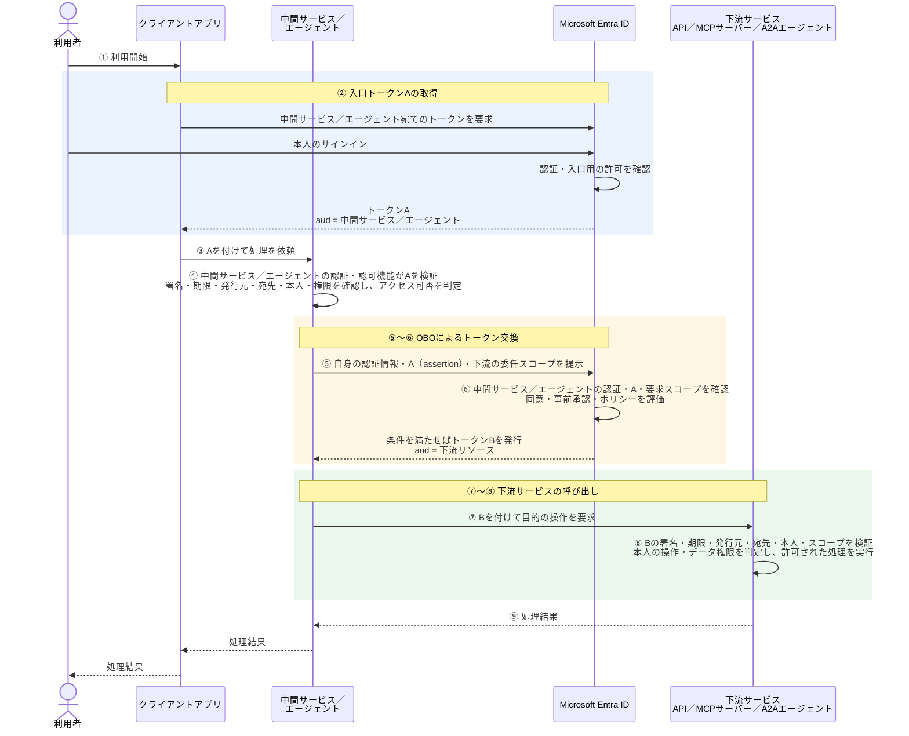

# OBOの基本

本書は概念と確認方法の説明であり、実環境の設定値・個別ユーザーの状態は含めない。製品・構成ごとの実機結果は[認証方式ごとの成立条件](Preview/認証方式と成立条件.md)と各マトリクスを参照する。

## 1. OBOとは

**OBO（On-Behalf-Of）は、中間サービス／エージェントが利用者本人の代理として、下流サービス（API・MCPサーバー・A2Aエージェントなど）にアクセスするための委任方式。**

Microsoft Entra IDのOBOフローでは、中間サービス／エージェントが、**その中間サービス／エージェントを呼ぶためにEntra IDが発行した、利用者本人のアクセストークン**を使い、アクセス先の保護対象リソース（下流リソース）宛ての別のアクセストークンを取得する。この処理を、ここでは「トークン交換」と呼ぶ。

トークン交換の実装主体は構成によって異なる。中間サービス／エージェントのアプリコードや認証ライブラリで実装（自作）する場合と、製品（Copilot StudioやMicrosoft Foundryなど）のOBO機能を利用する場合がある。

本書では、中間サービス／エージェント宛ての本人アクセストークンを**「入口トークンA」**、下流リソース宛てのアクセストークンを**「下流トークンB」**と呼ぶ。

### トークン取得から処理結果までの流れ

Microsoft Entra IDのOBOフローの成功経路を示す。アプリ登録・必要な権限の設定を前提とし、サインインや認可コード交換の細部はまとめて表記する。



④は、中間サービス／エージェントの入口でトークンAを検証し、アクセス可否を判定する処理を示す。例えば**Foundry Agent Serviceでは、この検証・判定をプラットフォームが行うため、エージェント内部にJWTの署名検証や入口の許可判定を自作する必要はない。** 開発者・管理者はエンドポイントの認可方式と許可条件を設定する。本書で扱う `AgentBlueprint` 方式では、`agent_endpoint.authorization_schemes` の `token_validation_rules` に宛先・テナント・クライアント・本人・必要スコープの条件を指定する。

参考：[Foundryのエージェントエンドポイント認可設定：AgentBlueprint方式（プレビュー）](https://learn.microsoft.com/en-us/azure/foundry/agents/how-to/configure-agent-endpoint-authorization#configure-agent-blueprint-access-preview)。

⑤は、中間サービス／エージェントが自身を認証し、トークンAを本人の委任の根拠（assertion）として提示し、下流の委任スコープを指定してEntra IDにトークン交換を要求する処理を示す。自身の認証情報は「どの中間サービス／エージェントが要求しているか」、Aは「誰の代理として要求しているか」を示す。例えば**Foundry Agent Serviceのnative OBOでは、この交換要求をプラットフォームが行うため、エージェント内部にトークン交換処理を自作する必要はない。** 開発者・管理者は、ツールが参照する接続に `authType=AgentOnBehalfOfUser` と下流リソースの完全修飾委任スコープを設定し、Blueprintの権限宣言・継承設定と必要な委任同意・事前承認も整える。

参考：[Foundryのツールのユーザー委任設定](https://learn.microsoft.com/en-us/azure/foundry/agents/how-to/configure-user-delegation)、[委任アクセスのEntra同意](https://learn.microsoft.com/en-us/azure/foundry/agents/concepts/entra-delegated-access-consent)。

有効なセッションやトークンを再利用できる場合、サインイン・同意・トークン交換を毎回行う必要はない。

### 入口トークンAと下流トークンBの内容・用途の比較

| 項目 | 入口トークンA | 下流トークンB |
| --- | --- | --- |
| 宛先 `aud` | 中間サービス／エージェント | 下流の保護対象リソース |
| 発行元 `iss` | Aを発行したEntra IDの発行元 | Bを発行したEntra IDの発行元 |
| テナント `tid` | Aを発行したEntraテナントのID | Bを発行したEntraテナントのID |
| 本人 `oid` | 入口で認証した利用者のObject ID | 下流へ代理アクセスする本人のObject ID |
| クライアント `azp`／`appid` | Aを取得したクライアントアプリのID | Bを取得した中間サービス／エージェント側のクライアントID |
| 権限 `scp` | 入口を利用するための委任スコープ | 下流を利用するための委任スコープ |
| 有効期限 `exp` | Aの有効期限 | Bの有効期限 |
| 署名（JWTの署名部分） | ④で検証する | ⑧で検証する |
| 利用する場所 | ③の中間サービス／エージェントへの呼び出しと、⑤の交換要求の `assertion` | ⑦の下流サービスへの呼び出し |

`aud`・`iss`・`tid`・`oid`・`scp`・`exp` などはトークン内のクレームであり、署名はJWTの署名部分にある。クライアントIDは、Entraアクセストークンの形式に応じてv2では `azp`、v1では `appid` で確認する。

### ⑤のトークン交換要求に含める項目

**`assertion` はトークン内のクレームではなく、Entra IDへの交換要求でトークンAを渡すパラメーター。** Microsoft Entra IDのOBO要求では、次の項目を使用する。

| 項目 | 指定する内容・役割 |
| --- | --- |
| `assertion` | トークンAそのもの。中間サービス／エージェント宛てに発行された本人のアクセストークンを、委任の根拠として提示する |
| `scope` | Bに要求する下流の委任スコープ。例：`api://<DOWNSTREAM_APP_ID>/session:scope:analyst` |
| `client_id` | トークン交換を要求する中間サービス／エージェント側のクライアントのApp ID |
| 自身の認証情報 | `client_secret` または証明書で署名した `client_assertion` など。要求元自身を認証するための情報で、本人のトークンAとは別 |
| `grant_type` | `urn:ietf:params:oauth:grant-type:jwt-bearer` |
| `requested_token_use` | `on_behalf_of`。OBOによる交換要求であることを指定する |

`scope` は要求する権限、Bの `scp` は実際に発行された委任権限を示す。また、`assertion` は本人のトークンA、`client_assertion` は要求元自身の認証に使う署名付きJWTであり、別のものである。⑥で評価する同意・事前承認・ポリシーは、これらの要求を許可するための設定・条件であり、トークンのクレームや同名の要求パラメーターではない。

参考：[Microsoft Entra IDのOBOフロー：中間サービスのトークン要求](https://learn.microsoft.com/en-us/entra/identity-platform/v2-oauth2-on-behalf-of-flow#middle-tier-access-token-request)。

- **OBOは、入口トークンをそのまま下流へ転送することではない。** 下流宛てではないトークンを下流が受け入れる設計にしない。
- OBOによって本人が別の管理者やアプリ主体に切り替わるわけではない。
- クライアントから本人のメールアドレスを送るだけではOBOにならない。
- 中間サービス自身の認証方法と、下流へのアクセスが本人委任かアプリ認証かは区別する。

## 2. アクセス許可を確認する3つの箇所

| 図との対応 | 確認箇所 | 判断する主体 | 確認すること |
| --- | --- | --- | --- |
| ④ | 中間サービス／エージェントへのアクセス | 中間サービス／エージェント側の認証・認可機能。Foundryではエンドポイントの認証・認可機能が担い、開発者・管理者は実装ではなく認可方式と許可条件を設定する | トークンAが有効で、本人とクライアントが入口の許可条件を満たすか |
| ⑥ | 下流トークンBの発行 | Entra ID | 要求元の認証、A、要求スコープ、適用される同意・事前承認・ポリシーが発行条件を満たすか |
| ⑧ | 下流サービスの操作・データへのアクセス | 下流サービスの認証・認可機能 | トークンBが有効で、必要なスコープと本人の操作・データ権限を満たすか |

## 3. スコープは何を許可するのか

委任スコープは、**アプリが本人の代理で「何をしてよいか」を表す権限**である。その名前と許可する操作は、下流APIの提供者が定義する。

例えば、注文APIが次のスコープを定義しているとする。

```text
orders.read ＝ 本人の代理で注文情報を読む
```

OBOでは、次のように使う。

```text
⑤ 中間サービス／エージェント
   「本人の代理で注文情報を読みたい」とEntraに要求する
       ↓
⑥ Entra ID
   同意などの発行条件を確認し、orders.readを含むトークンBを発行する
       ↓
⑦ 中間サービス／エージェント
   トークンBを付けて注文APIを呼び出す
       ↓
⑧ 注文APIの認証・認可機能
   Bを受け取り、トークンが有効で、scpにorders.readがあることを確認する
```

API側には、注文情報を読む処理を実装し、**`scp` に `orders.read` がある場合だけ、その処理を許可する**認可の仕組みを実装・設定する。Entraにスコープを定義するだけで、APIの処理やアクセス制限が自動的に作られるわけではない。

本人ごとに見せる注文を制限する場合は、その制限もAPI側で実装・設定する。

## 4. 同意する人と、代理される本人は別

同意とは、**「このアプリが、本人の代理で、このスコープの操作を行ってよい」と許可すること**である。

例えば、利用者がエージェントに注文情報を調べてもらう場合、同意する内容は次のようになる。

```text
このエージェントに、
利用者本人の代理で、
注文情報を読む権限（orders.read）を使わせてよい
```

**誰が操作するかと、誰について許可するかは別である。** 同意の対象範囲と、操作するタイミングの例は次のとおり。

| ケース | 操作する人 | 同意が適用される利用者 | タイミングの例 |
| --- | --- | --- | --- |
| 本人による同意 | 利用者本人 | その本人 | 初回利用時など、同意が求められたとき |
| 管理者による個別の許可付与 | 権限を持つ管理者 | 指定した利用者 | 本人が使い始める前に、管理者がその人の分を許可する |
| 管理者による組織全体への一括同意 | 権限を持つ管理者 | 組織内の全利用者 | 利用展開前の準備、または追加の権限を承認するとき |

管理者が個別に許可を付与した場合、**その利用者は、自分で同意操作をせずに利用できる。** 利用時に本人のサインインは引き続き必要である。

本人が同意できるか、管理者の同意が必要かは、要求する権限と組織のポリシーによって決まる。

Entraはシーケンス⑥で、必要な同意があるかを確認する。有効な同意が既にあれば、毎回同意する必要はない。

**管理者が同意しても、エージェントが管理者の代理になるわけではない。** この例で代理される本人は、実行時に注文情報を調べてもらう利用者である。

## 5. Foundryでは誰が何をするか

Foundryのnative OBOでは、シーケンス図の「中間サービス／エージェント」の処理をFoundryが担う。

| 主体 | 何をするか |
| --- | --- |
| Foundry側の開発者・管理者 | Foundryエンドポイントの認証・認可条件と、ツール接続の下流接続先・要求スコープを設定する（注） |
| （下流API側の開発者・管理者） | 下流APIをEntra IDにアプリ登録し、委任スコープ（例：`orders.read`）を公開する。API側でトークンを検証し、本人の操作・データへのアクセスを認可する |
| 利用者本人または権限を持つ管理者 | 第4章で説明した同意操作を行う |
| Foundry | ④本人トークンAを検証し、⑤下流トークンBを要求して、⑦Bを付けて下流を呼び出す |
| Entra ID | ⑥発行条件を確認し、条件を満たせばBを発行する |
| 下流サービス | ⑧Bと必要な権限を確認し、許可された処理を実行する |

Entra管理センターでアプリを登録すると、同じテナントに対応するエンタープライズ アプリケーション（サービスプリンシパル）も自動作成されるため、通常は別途作成する必要はない。API等でアプリを作成する場合は、サービスプリンシパルの作成が別途必要になることがある。

注：**確認した環境のMCP追加GUIには、native OBOに必要な設定項目がなかった。実機検証の際は、API経由で接続を設定している。**

**トークン交換処理をエージェント内に自作する必要はないが、必要な設定と同意は用意する。**

具体的な設定要件は[認証方式ごとの成立条件](Preview/認証方式と成立条件.md)を参照する。

## 6. エラーと成功の見方

- **401**：通常は要求先での認証・トークン受け入れ条件を調べる。入口の401なのか、下流の401なのかを分ける。
- **403**：通常は権限不足を調べる。必要なスコープ、本人の登録・ロール・データ権限などを確認する。
- **同意要求・トークン取得エラー**：対象のアプリ、リソース、スコープ、テナントポリシー、適用される同意・事前承認を確認する。
- **HTTP 200なのにツール失敗**：入口APIの応答と、内部のツール完了・下流の処理結果を分ける。上位応答の `error: null` だけではツール成功にならない。

製品やプロキシがエラーを包む場合があるため、ステータスコードだけで原因を断定しない。ツールの `status`・`error`、同意要求、相関ID、下流の受信・拒否ログを確認する。

成功時は、入口の本人、実際のツール呼び出し、下流で検証された本人・宛先・スコープ、処理結果を照合する。モデルが生成した「OBO成功」という文章や、JWTをデコードした表示だけでは証拠にならない。生のトークン・認可コード・同意URLは公開証跡に残さない。

## 7. 別方式・別テナントとの区別

- **個別OAuth**：下流用に別のOAuthセッションを作る方式。入口と同じ本人がサインインしていても、入口トークンからのOBOと同一ではない。
- **アプリ認証／MI**：アプリ自身の権限によるアクセス。本人の委任スコープを自動継承しない。Microsoft Entraの標準OBOフローを、アプリ専用トークンの交換として使わない。
- **別テナント**：ホスト場所、アプリ登録先、トークン発行元を分ける。同じ人でもテナントが異なれば `tid`・`oid` が異なり得る。OBOが自動的に別テナントの本人へ変換するわけではない。
- **接続プロトコル**：HTTP／OpenAPI、MCP、A2Aの違いとOBOの対応可否は別。あるツールでの成功を、別のツール方式へ読み替えない。

テナントのモデルは[構成と用語](Preview/構成と用語.md)、方式別の条件は[認証方式ごとの成立条件](Preview/認証方式と成立条件.md)、証跡の読み方は[検証方法と限界](Preview/検証方法と限界.md)を参照する。

## 公式資料

- [Microsoft Entra ID：OAuth 2.0 On-Behalf-Ofフロー](https://learn.microsoft.com/en-us/entra/identity-platform/v2-oauth2-on-behalf-of-flow)
- [Microsoft Entra ID：権限と同意の概要](https://learn.microsoft.com/en-us/entra/identity-platform/permissions-consent-overview)
- [Microsoft Graph：oauth2PermissionGrant](https://learn.microsoft.com/en-us/graph/api/resources/oauth2permissiongrant?view=graph-rest-1.0)
- [Microsoft Graph：permissionScope](https://learn.microsoft.com/en-us/graph/api/resources/permissionscope?view=graph-rest-1.0)
- [Foundry：ツールのユーザー委任設定](https://learn.microsoft.com/en-us/azure/foundry/agents/how-to/configure-user-delegation)
- [Foundry：委任アクセスのEntra同意](https://learn.microsoft.com/en-us/azure/foundry/agents/concepts/entra-delegated-access-consent)

関連：[個別OAuthの基本](個別OAuthの基本.md)、[アプリ認証とMIの基本](アプリ認証とMIの基本.md)。

次：[クロステナントOBO-ゲストユーザー](クロステナントOBO-ゲストユーザー.md)。
