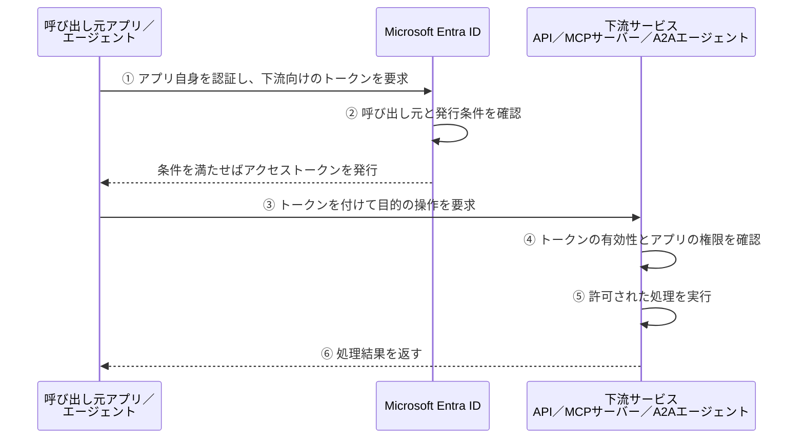

# アプリ認証／MIの基本

アプリが誰の権限で下流サービスを呼び出すのかを、Microsoft Entra IDを使う構成で説明する。

## 1. アプリ認証とは

**アプリ認証は、利用者本人の代理ではなく、アプリ自身として下流サービスにアクセスする方式である。**

例えば、注文情報を毎晩集計するアプリは、利用者の代わりにサインインするのではなく、そのアプリに付与された権限で注文APIを呼び出す。

```text
本人OBO    ：「この利用者の代理で、注文情報を読みたい」
アプリ認証 ：「このアプリ自身として、注文情報を読みたい」
```

アプリは、自分自身を認証して下流サービス向けのアクセストークンを取得する。本人トークンを下流用に交換するOBOとは異なる。

## 2. MIとは

**MI（Managed Identity：マネージドID）は、Azureが管理する、アプリやサービスのためのIDである。MIを使うアクセスも、アプリ認証の一つである。**

| 自分自身を認証する方法 | 誰が認証情報を管理するか |
| --- | --- |
| アプリ登録のクライアントシークレットや証明書を使う | 開発者・管理者が準備し、保管・更新する |
| MIを使う | Azureが管理する。開発者がシークレットをコードや設定に保存する必要はない |

MIを使うアプリは、Azureのトークン取得機能を通じて、そのMIのアクセストークンを取得する。

**MIを用意しただけでは、下流サービスを利用する権限は付かない。** そのMIに必要な権限を別途付与する。

## 3. トークン取得から処理結果までの流れ

次はアプリ認証の基本の流れである。MIの場合も、本人の代理ではなく、そのMI自身としてトークンを取得して下流を呼び出す。



MIでは、①のトークン取得をAzureの機能を介して行う。アプリがEntraにMIのシークレットを直接送る、という意味ではない。

トークンを発行するのはEntra、実際の操作を許可・実行するのは下流サービスである。

## 4. アプリにはどの権限を付けるのか

下流サービスを管理する権限を持つ管理者などが、**呼び出し元のアプリやMIに、必要な操作の権限を付与する。**

例えば、注文APIがアプリ向けの権限をアプリロールとして定義している場合、次のようになる。

```text
注文API側が定義する権限
  Orders.Read ＝ アプリが注文情報を読む
      ↓
その権限を、呼び出し元のアプリやMIに付与する
      ↓
発行されたアクセストークンのrolesにOrders.Readが入る
      ↓
注文APIが、有効なトークンのrolesにOrders.Readがあることを確認する
```

API側には、注文情報を読む処理と、**必要なアプリロールがある場合だけ、その処理を許可する仕組み**を実装・設定する。`Orders.Read` という名前から、EntraがAPIの処理を自動的に制限するわけではない。

上はアプリロールを使う例である。Azure Storageなど、Azure RBACでMIの権限を管理するサービスもある。権限の付与・確認は、下流サービスの方式に従う。

## 5. Foundryでは誰が何をするか

例えば、Foundryのツール接続でプロジェクトMIを使う場合、**下流にアクセスする主体は、そのプロジェクトのMI**である。

| 主体 | 何をするか |
| --- | --- |
| Foundry側の開発者・管理者 | 下流の接続先、プロジェクトMIを使う認証方式、トークンの宛先となるリソースを設定する |
| （下流API側の開発者・管理者） | APIの権限を定義し、トークン・権限の確認と業務処理を実装・設定する |
| 権限付与を行う管理者 | プロジェクトMIに、下流で必要な権限を付与する |
| Foundry | プロジェクトMIのトークンを取得し、そのトークンで下流を呼び出す |
| 下流サービス | トークンとMIの権限を確認し、許可された処理を実行する |

利用者がFoundryにサインインしていても、**下流に渡すのはプロジェクトMIのトークンであり、利用者本人のトークンではない。**

## 6. OBOとの違い

| 比較すること | 本人OBO | アプリ認証／MI |
| --- | --- | --- |
| 下流に対して誰としてアクセスするか | 利用者本人の代理 | アプリやMI自身 |
| 下流アクセスに本人トークンを使うか | OBOの根拠として使う | 使わない |
| 下流で確認する権限 | 本人の代理アクセスに必要な委任権限 | アプリやMIに付与された権限 |

**本人に許可された範囲で代理操作するのか、アプリに付与した範囲で操作するのか**が違いである。

チャットアプリやFoundryを利用するための本人サインインは、下流へのアプリ認証とは別の話である。

## 公式資料

- [Microsoft Entra ID：OAuth 2.0 クライアント資格情報フロー](https://learn.microsoft.com/en-us/entra/identity-platform/v2-oauth2-client-creds-grant-flow)
- [Microsoft Entra ID：AzureリソースのマネージドID](https://learn.microsoft.com/en-us/entra/identity/managed-identities-azure-resources/overview)
- [Foundry：MCPサーバーの認証設定](https://learn.microsoft.com/en-us/azure/foundry/agents/how-to/mcp-authentication)

関連：[OBOの基本](OBOの基本.md)。製品別の設定要件は[認証方式ごとの成立条件](認証方式と成立条件.md)、実機結果は[アプリ認証マトリクス](アプリ認証マトリクス.md)を参照。

次：[API：HTTP／OpenAPIの基本](API_HTTP_OpenAPIの基本.md)。
