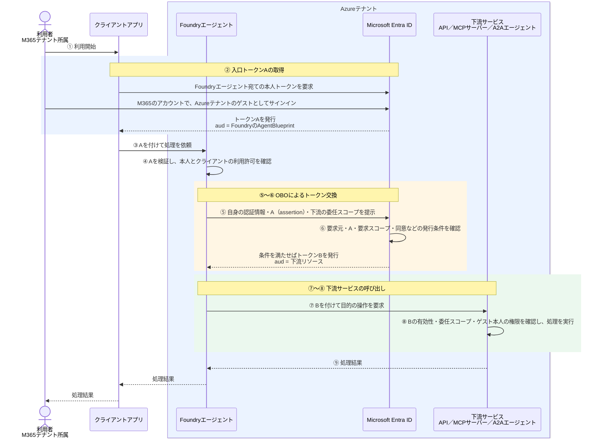

# クロステナントOBO-ゲストユーザー

[OBOの基本](OBOの基本.md)をもとに、M365テナントの利用者をAzureテナントにゲスト招待し、AzureテナントのFoundryから同じAzureテナントの下流サービスへ本人の代理でアクセスする構成を説明する。

## 1. 今回の構成とOBO

| 対象 | 所属・配置先 |
| --- | --- |
| 利用者 | M365テナント。Azureテナントにゲストとして登録する |
| Foundryエージェント | Azureテナント |
| 下流サービス | Foundryと同じAzureテナント |

ここでは、次を前提とする。

- Foundryと下流サービスの認証先、および下流APIを表すアプリの登録先はAzureテナントとする。
- M365テナントの利用者をAzureテナントにゲストとして招待し、Foundryエージェントを利用する権限を付与する。
- Foundryのnative OBOに対応するMCP／A2Aツールを使い、エンドポイントは `AgentBlueprint` 方式、ツール接続は `AgentOnBehalfOfUser` とする。これらの機能はプレビューである。
- Azureテナントで、クライアントからFoundryへのアクセスと、Foundryから下流への代理アクセスに必要な設定・同意を整える。

```text
M365テナントの利用者
    ↓ AzureテナントのゲストとしてFoundryを利用
AzureテナントのFoundry
    ↓ Azureテナントのゲスト本人の代理としてアクセス
Azureテナントの下流サービス
```

**テナントをまたぐのは利用者のFoundryへのアクセスである。OBOのトークン交換は、Azureテナントのゲストとしての本人を対象に、Azureテナントで行う。**

### トークン取得から処理結果までの流れ

②の本人認証にはM365のアカウントを使うが、Foundry用のトークンを発行するのはAzureテナントのEntra IDである。サインインの細部はまとめて示す。



⑤の交換要求はFoundryが行う。エージェント内にトークン交換処理を自作する必要はない。

### トークンAとBは誰を表すか

| 項目 | Foundry用のトークンA | 下流用のトークンB |
| --- | --- | --- |
| 宛先 `aud` | FoundryエージェントのAgentBlueprint | 下流の保護対象リソース |
| 発行元・テナント `iss`・`tid` | Azureテナント | Azureテナント |
| 本人 `oid` | Azureテナントのゲスト利用者のObject ID | 同じAzureテナントのゲスト利用者のObject ID |
| 権限 `scp` | Foundryエージェントを利用する委任スコープ | 下流サービスを利用する委任スコープ |
| 利用する場所 | ③のFoundry呼び出しと、⑤の交換要求の `assertion` | ⑦の下流サービス呼び出し |

**下流が確認する本人は、M365テナントでのObject IDではなく、AzureテナントのゲストとしてのObject IDである。** 同じ人でも、テナントが異なればObject IDは異なる。

この構成は、M365テナント発行のトークンをそのままAzureテナントの下流へ送る方式ではない。

## 2. アクセス許可を確認する3つの箇所

| 図との対応 | 確認箇所 | 判断する主体 | 確認すること |
| --- | --- | --- | --- |
| ④ | Foundryエージェントへのアクセス | Foundryエンドポイントの認証・認可機能 | Azureテナント発行のAが有効で、ゲスト本人とクライアントが利用条件を満たすか |
| ⑥ | 下流トークンBの発行 | AzureテナントのEntra ID | 要求元・A・要求スコープ・必要な同意などが発行条件を満たすか |
| ⑧ | 下流サービスの操作・データへのアクセス | 下流サービスの認証・認可機能 | Bが有効で、必要なスコープとゲスト本人の操作・データ権限を満たすか |

## 3. スコープは何を許可するのか

委任スコープは、**Foundryエージェントが、Azureテナントのゲスト本人の代理で「何をしてよいか」を表す権限**である。その名前と許可する操作は、下流APIの提供者が定義する。

例えば、Azureテナントの注文APIが次のスコープを定義しているとする。

```text
orders.read ＝ 本人の代理で注文情報を読む
```

この構成では、次のように使う。

```text
⑤ Foundry
   「ゲスト本人の代理で注文情報を読みたい」とAzureテナントのEntraに要求する
       ↓
⑥ AzureテナントのEntra ID
   同意などの発行条件を確認し、orders.readを含むトークンBを発行する
       ↓
⑦ Foundry
   Bを付けて注文APIを呼び出す
       ↓
⑧ 注文APIの認証・認可機能
   Bを受け取り、有効で、scpにorders.readがあることを確認する
```

API側には、注文情報を読む処理を実装し、**`scp` に `orders.read` がある場合だけ、その処理を許可する**認可の仕組みを実装・設定する。Entraにスコープを定義するだけで、APIの処理やアクセス制限が自動的に作られるわけではない。

本人ごとに見せる注文を制限する場合は、Azureテナントのゲスト本人を対象に、その制限もAPI側で実装・設定する。

## 4. 同意する人と、代理される本人は別

同意する内容は、次のようになる。

```text
このFoundryエージェントに、
Azureテナントのゲスト本人の代理で、
注文情報を読む権限（orders.read）を使わせてよい
```

同意は、下流リソースのサービスプリンシパルとゲスト本人が存在するAzureテナントで整える。

| ケース | 操作する人 | 同意が適用される利用者 | タイミングの例 |
| --- | --- | --- | --- |
| 本人による同意 | ゲスト利用者本人 | Azureテナントのゲストとしての本人 | 初回利用時など、同意が求められたとき |
| 管理者による個別の許可付与 | Azureテナントで必要な権限を持つ管理者 | 指定したゲスト利用者 | 本人が使い始める前に、その人の分を許可する |
| 管理者による組織全体への一括同意 | Azureテナントで必要な権限を持つ管理者 | Azureテナントの利用者。ゲストも含む | 利用展開前の準備など |

本人が同意できるかは、要求する権限とAzureテナントのポリシーによって決まる。管理者が必要な許可を付与済みなら、本人の同意操作は不要になるが、利用時の本人サインインは必要である。

**管理者が同意しても、代理される本人はゲスト利用者のままである。** また、ゲスト招待やFoundryへのアクセス許可だけでは、下流への委任同意を満たさない。

## 5. Foundryでは誰が何をするか

| 主体 | 何をするか |
| --- | --- |
| Azureテナントの利用者アクセスを管理する担当者 | M365テナントの利用者をゲストとして招待し、Foundryを利用するための権限・許可条件を整える |
| Foundry側の開発者・管理者 | エンドポイントの認証・認可条件と、OBOツール接続の下流接続先・要求スコープを設定する |
| （Azureテナントの下流API側の開発者・管理者） | 下流APIをAzureテナントのEntra IDにアプリ登録し、委任スコープ（例：`orders.read`）を公開する。API側でトークンを検証し、本人の操作・データへのアクセスを認可する |
| ゲスト利用者本人または権限を持つ管理者 | Azureテナントで、第4章で説明した同意操作を行う |
| Foundry | ④本人トークンAを検証し、⑤下流トークンBを要求して、⑦Bを付けて下流を呼び出す |
| AzureテナントのEntra ID | ②本人トークンAを発行し、⑥下流の発行条件を確認して、条件を満たせばBを発行する |
| 下流サービス | ⑧Bとゲスト本人の権限を確認し、許可された処理を実行する |

Entra管理センターでアプリを登録すると、同じテナントに対応するエンタープライズ アプリケーション（サービスプリンシパル）も自動作成されるため、通常は別途作成する必要はない。API等でアプリを作成する場合は、サービスプリンシパルの作成が別途必要になることがある。

**トークン交換処理はFoundryが行うが、ゲスト登録・利用許可・接続設定・同意は別途用意する。**

具体的な製品設定は[認証方式ごとの成立条件](Preview/認証方式と成立条件.md)を参照する。

## 6. エラーと成功の見方

| 止まる箇所 | 主に確認すること |
| --- | --- |
| ②のサインイン・Aの取得 | Azureテナントのゲスト登録、サインイン先、クライアントの権限・同意 |
| ④のFoundryへのアクセス | Aの発行元・宛先、ゲスト本人とクライアントの許可条件 |
| ⑥のBの取得 | Azureテナントでの下流への委任同意、要求スコープ、ポリシー |
| ⑧の下流APIの操作 | Bの有効性、必要なスコープ、Azureテナントのゲスト本人の操作・データ権限 |

Foundryにログインできたことと、下流の操作が成功したことは別である。成功時は、⑧でAzureテナントのゲスト本人として許可された操作が実行されたことを確認する。

## 7. アプリ認証／MIとの違い

| 比較すること | この構成のOBO | プロジェクトMIによるアプリ認証 |
| --- | --- | --- |
| 下流でのアクセス主体 | Azureテナントのゲスト本人の代理 | AzureテナントのプロジェクトMI自身 |
| トークンBの取得 | 本人トークンAを委任の根拠として使う | MI自身として取得する。Aを交換するのではない |
| 下流で確認する権限 | 委任スコープと、必要な本人の権限 | MIに付与された権限 |

同じゲスト利用者が同じFoundryを使っていても、**下流で本人の代理として動くのか、MI自身として動くのか**が異なる。

## 公式資料

- [Microsoft Entra ID：OAuth 2.0 On-Behalf-Ofフロー](https://learn.microsoft.com/en-us/entra/identity-platform/v2-oauth2-on-behalf-of-flow)
- [MSAL.NET：ゲスト利用者のOBOとテナント指定](https://learn.microsoft.com/en-us/entra/msal/dotnet/acquiring-tokens/web-apps-apis/on-behalf-of-flow#important-note-on-on-behalf-of-obo-flow-with-guest-users)
- [Microsoft Entra ID：B2Bコラボレーション](https://learn.microsoft.com/en-us/entra/external-id/what-is-b2b)
- [Foundry：ユーザー委任の設定](https://learn.microsoft.com/en-us/azure/foundry/agents/how-to/configure-user-delegation)
- [Foundry：委任アクセスのEntra同意](https://learn.microsoft.com/en-us/azure/foundry/agents/concepts/entra-delegated-access-consent)
- [Foundry：エージェントエンドポイントの認可設定](https://learn.microsoft.com/en-us/azure/foundry/agents/how-to/configure-agent-endpoint-authorization)

関連：[OBOの基本](OBOの基本.md)、[クロステナントアプリ認証とMI-ゲストユーザー](クロステナントアプリ認証とMI-ゲストユーザー.md)。

次：[クロステナントOBO-非ゲストユーザー](クロステナントOBO-非ゲストユーザー.md)。
