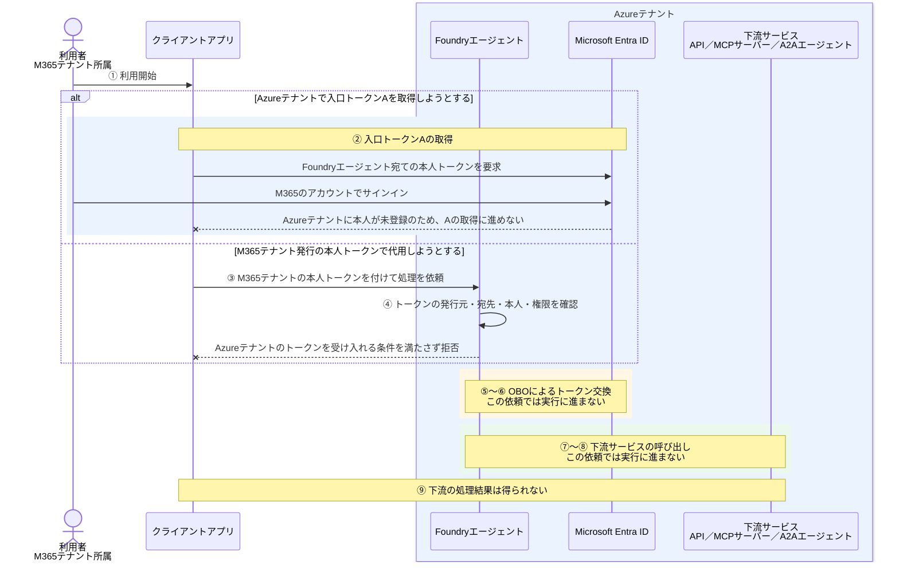

# クロステナントOBO-非ゲストユーザー

[ゲストユーザー版](クロステナントOBO-ゲストユーザー.md)と同じ配置で、M365テナントの利用者をAzureテナントに登録しない場合を説明する。

**Foundryと下流サービスの認証先をAzureテナントのままにする場合、ゲスト招待だけを省いても、ゲストユーザー版と同じOBOは成立しない。**

## 1. 今回の構成とOBO

| 対象 | 所属・配置先 |
| --- | --- |
| 利用者 | M365テナント。Azureテナントには利用者登録がない |
| Foundryエージェント | Azureテナント |
| 下流サービス | Foundryと同じAzureテナント |

ここでは、次を前提とする。

- Foundryと下流サービスの認証先、および下流APIを表すアプリの登録先はAzureテナントとする。
- 「非ゲスト」は、ゲスト招待だけでなく、ほかの方法によるAzureテナントへの利用者登録も行わない状態を指す。
- 利用者本人のトークンでFoundryを直接呼び出す。エンドポイントは `AgentBlueprint` 方式で、受け入れるテナントはAzureテナントとする。
- 下流には、Azureテナントの本人を表す委任トークンでアクセスする。ツール接続は `AgentOnBehalfOfUser` とする。これらのFoundry機能はプレビューである。

```text
M365テナントの利用者
    ↓ Azureテナントには利用者登録がない
AzureテナントのFoundry
    × Azureテナントの本人としてのアクセスが成立しない
Azureテナントの下流サービス
    本人の代理アクセスには到達しない
```

M365のアカウントにサインインできることと、Azureテナントの本人としてトークンを取得できることは別である。

### トークン取得から処理結果までの流れ

ゲストユーザー版と同じ①〜⑨を使い、どこで先に進めなくなるかを示す。



### トークンAとBは誰を表すか

| 項目 | ゲストユーザー版 | この構成 |
| --- | --- | --- |
| Azureテナントの本人 | ゲストとして登録されている | 登録されていない |
| Azureテナント発行の入口トークンA | Azureテナントのゲスト本人を表す | 同じ本人トークンを取得する前提を満たさない |
| M365テナント発行の本人トークン | Azureテナント発行のAの代わりには使わない | Azureテナントの本人登録や、入口の受け入れ条件を代用しない |
| Azureテナント発行の下流トークンB | 同じゲスト本人を表す | この依頼からは取得に進まない |

**OBOは、M365テナントの本人を自動的にAzureテナントの本人へ変換する仕組みではない。**

**不成立という結論は、Azure側に本人登録がなく、入口・下流の認証先をAzureテナントに固定した本書の前提に限る。非ゲストのすべての構成でOBOが不成立という意味ではない。**
