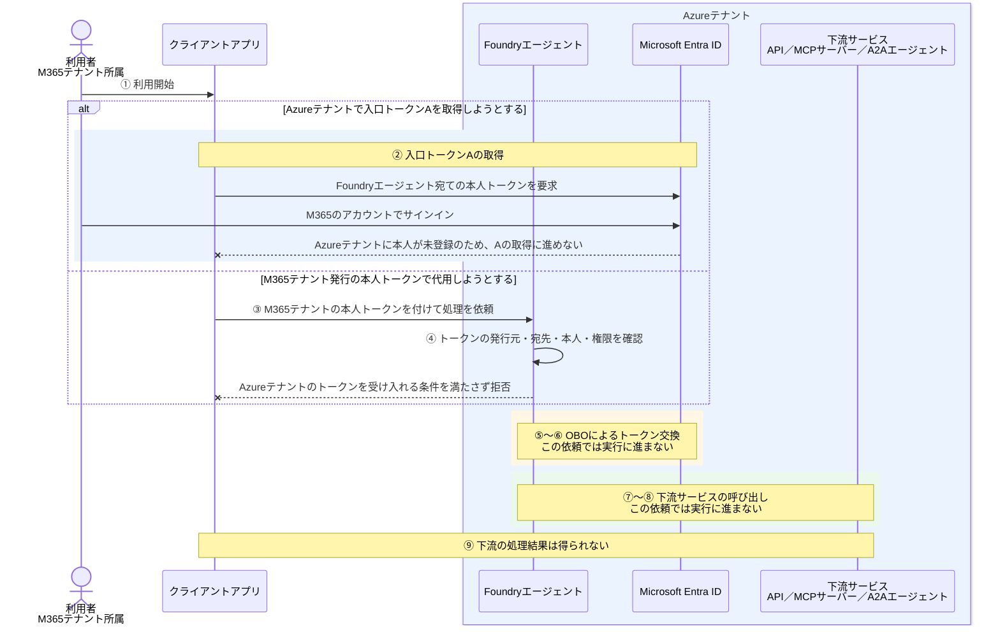

# クロステナントOBO-非ゲストユーザー

[ゲストユーザー版](クロステナントOBO-ゲストユーザー.md)と同じ配置で、M365テナントの利用者をAzureテナントに登録しない場合を説明する。

**Foundryと下流サービスの認証先をAzureテナントのままにする場合、ゲスト招待だけを省いても、ゲストユーザー版と同じOBOは成立しない。**

## 1. 今回の構成とOBO

| 対象 | 所属・配置先 |
| --- | --- |
| 利用者 | M365テナント。Azureテナントには利用者登録がない |
| Foundryエージェント | Azureテナント |
| 下流サービス | Foundryと同じAzureテナント |

ここでは、次を前提とする。

- Foundryと下流サービスの認証先、および下流APIを表すアプリの登録先はAzureテナントとする。
- 「非ゲスト」は、ゲスト招待だけでなく、ほかの方法によるAzureテナントへの利用者登録も行わない状態を指す。
- 利用者本人のトークンでFoundryを直接呼び出す。エンドポイントは `AgentBlueprint` 方式で、受け入れるテナントはAzureテナントとする。
- 下流には、Azureテナントの本人を表す委任トークンでアクセスする。ツール接続は `AgentOnBehalfOfUser` とする。これらのFoundry機能はプレビューである。

```text
M365テナントの利用者
    ↓ Azureテナントには利用者登録がない
AzureテナントのFoundry
    × Azureテナントの本人としてのアクセスが成立しない
Azureテナントの下流サービス
    本人の代理アクセスには到達しない
```

M365のアカウントにサインインできることと、Azureテナントの本人としてトークンを取得できることは別である。

### トークン取得から処理結果までの流れ

ゲストユーザー版と同じ①〜⑨を使い、どこで先に進めなくなるかを示す。



### トークンAとBは誰を表すか

| 項目 | ゲストユーザー版 | この構成 |
| --- | --- | --- |
| Azureテナントの本人 | ゲストとして登録されている | 登録されていない |
| Azureテナント発行の入口トークンA | Azureテナントのゲスト本人を表す | 同じ本人トークンを取得する前提を満たさない |
| M365テナント発行の本人トークン | Azureテナント発行のAの代わりには使わない | Azureテナントの本人登録や、入口の受け入れ条件を代用しない |
| Azureテナント発行の下流トークンB | 同じゲスト本人を表す | この依頼からは取得に進まない |

**OBOは、M365テナントの本人を自動的にAzureテナントの本人へ変換する仕組みではない。**

## 2. アクセス許可を確認する3つの箇所

| 図との対応 | 確認箇所 | この構成での扱い |
| --- | --- | --- |
| ④ | Foundryエージェントへのアクセス | ②でAzureテナントのAを取得できない。M365テナントのトークンを提示しても、設定した受け入れ条件を満たさない |
| ⑥ | 下流トークンBの発行 | 入口で止まるため到達しない。下流の委任同意だけを用意しても、入口の問題は解消しない |
| ⑧ | 下流サービスの操作・データへのアクセス | Bを使った呼び出しに到達しない |

`AgentBlueprint` には `allowed_tenants` などの受け入れ条件がある。**Azure RBAC方式と同じ理由で拒否される、と説明するものではない。**

また、M365テナントを入口で許可するだけでは、Azureテナントの本人登録や、Azureテナント発行のBの取得条件まで満たしたことにはならない。

## 3. スコープは何を許可するのか

委任スコープの意味は、ゲストユーザー版と同じである。例えば、Azureテナントの注文APIが次のスコープを定義しているとする。

```text
orders.read ＝ 本人の代理で注文情報を読む
```

API側には、トークンの有効性と `scp` の値、必要な本人の操作・データ権限を確認し、注文情報を読む処理を許可する仕組みを実装・設定する。

**スコープの定義やFoundryの接続設定を用意しても、Azureテナントに未登録の本人を登録済みにすることはできない。**

## 4. 同意する人と、代理される本人は別

委任同意は、エージェントが本人の代理で委任スコープを使うことへの許可である。利用者登録やFoundryの入口の許可とは別に準備する。

| 操作 | この構成で解決するか |
| --- | --- |
| M365テナントで本人が同意する | Azureテナントの本人登録や、Azure側の委任同意を代用しない |
| Azureテナントで管理者が組織全体に同意する | 本人の登録・入口の許可は別であり、それだけでは解決しない |
| Azureテナントで本人の分の同意を用意する | Azure側の本人を対象にするには、その本人の登録が必要になる |

**管理者が同意しても、未登録の利用者が自動的にゲストとして登録されるわけではない。**

## 5. Foundryでは誰が何をするか

| 主体 | 何をするか |
| --- | --- |
| Azureテナントの利用者アクセスを管理する担当者 | この前提では本人を登録しないため、Azureテナントの本人として利用する準備が整わない |
| Foundry側の開発者・管理者 | ④の入口の受け入れ条件と、⑤のOBO接続先・要求スコープを設定する。接続設定だけで本人登録を代用しない |
| （Azureテナントの下流API側の開発者・管理者） | 下流APIをAzureテナントのEntra IDにアプリ登録し、委任スコープ（例：`orders.read`）を公開する。API側で⑧のトークンを検証し、本人の操作・データへのアクセスを認可する |
| 同意を行う本人または権限を持つ管理者 | 第4章の委任同意を行う。同意だけでは②・④の問題を解消できない |
| クライアントアプリ | ②Azureテナントの本人トークンAを取得できない。または③M365テナントの本人トークンを提示しても入口の条件を満たさない |
| Foundry | ④の条件を満たさない呼び出しを拒否し、⑤以降に進めない |
| AzureテナントのEntra ID | ②本人の登録・認証条件を確認する。この依頼は⑥の下流トークン発行には進まない |
| 下流サービス | この本人の依頼からは⑦の呼び出しに到達しない |

Entra管理センターでアプリを登録すると、同じテナントに対応するエンタープライズ アプリケーション（サービスプリンシパル）も自動作成されるため、通常は別途作成する必要はない。API等でアプリを作成する場合は、サービスプリンシパルの作成が別途必要になることがある。ただし、下流APIの準備だけでは、本書の前提で不足しているAzure側の本人登録を補えない。

## 6. エラーと成功の見方

| 確認箇所 | 確認すること |
| --- | --- |
| ②のサインイン・Aの取得 | サインイン先がAzureテナントか、そのテナントに本人が登録されているか |
| ④のFoundryへのアクセス | Aの発行元・宛先と、エンドポイントのテナント・クライアント・本人・スコープの受け入れ条件 |
| ⑤〜⑥のトークン交換 | 入口の許可とは別に、本人のテナント、要求元、下流リソース、スコープ・同意が整合しているか |
| ⑦〜⑧の下流アクセス | 下流がどのテナントの、誰のトークンを受け入れる設計なのか |

Entraの通常のOBOでは、入力トークンの `tid` に対応するテナントで交換する。**M365テナントのAを、交換先だけAzureテナントに変えて、Azureテナントの本人を表すBにできるとは扱わない。**

ゲスト招待を使わない別の構成として、Azureに配置した下流APIでもM365テナント発行のトークンを受け入れる設計は考えられる。ただし、アプリのマルチテナント対応、M365側のサービスプリンシパル・同意、Foundryの対応条件などを別途確認する必要がある。これは、**下流の認証先をAzureテナントに固定した本書の構成とは別**である。

本書の非成立を、「非ゲスト利用者のOBOは、どの認証先・製品構成でも成立しない」という意味には広げない。

## 7. アプリ認証／MIとの違い

| 比較すること | この構成のOBO | プロジェクトMIによるアプリ認証 |
| --- | --- | --- |
| 下流でのアクセス主体 | 利用者本人の代理 | プロジェクトMI自身 |
| 下流トークンBの取得 | 本人トークンAを委任の根拠として使う | MI自身の発行条件で取得する |
| 入口で本人のアクセスが成立しない場合 | この依頼はOBOの交換に進まない | 本人が直接Foundryを呼ぶ構成では、MIの権限だけでは入口の問題を解決しない |

MIに切り替えて下流を呼び出しても、それは本人のOBOが成立したことにはならない。

## 公式資料

- [Microsoft Entra ID：OAuth 2.0 On-Behalf-Ofフロー](https://learn.microsoft.com/en-us/entra/identity-platform/v2-oauth2-on-behalf-of-flow)
- [MSAL.NET：OBOのテナント指定](https://learn.microsoft.com/en-us/entra/msal/dotnet/acquiring-tokens/web-apps-apis/on-behalf-of-flow#important-note-on-on-behalf-of-obo-flow-with-guest-users)
- [Foundry：ユーザー委任の設定](https://learn.microsoft.com/en-us/azure/foundry/agents/how-to/configure-user-delegation)
- [Foundry：AgentBlueprintの認可設定](https://learn.microsoft.com/en-us/azure/foundry/agents/how-to/configure-agent-endpoint-authorization#configure-agent-blueprint-access-preview)

関連：[ゲストユーザー版](クロステナントOBO-ゲストユーザー.md)、[OBOの基本](OBOの基本.md)、[クロステナントアプリ認証とMI-非ゲストユーザー](クロステナントアプリ認証とMI-非ゲストユーザー.md)。

次：[アプリ認証／MIの基本](アプリ認証とMIの基本.md)。
