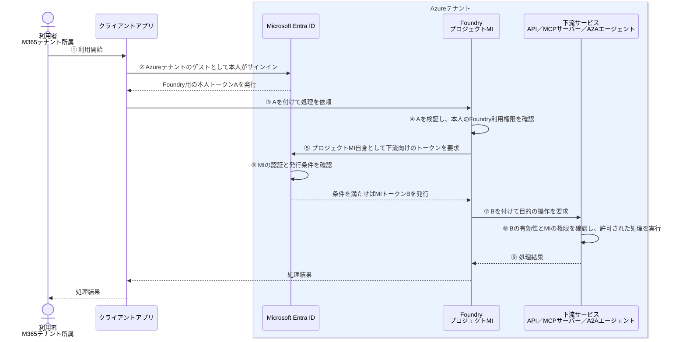

# クロステナントアプリ認証とMI-ゲストユーザー

[アプリ認証／MIの基本](アプリ認証とMIの基本.md)をもとに、M365テナントの利用者が、AzureテナントのFoundryを使い、同じAzureテナントの下流サービスを呼び出す構成を説明する。

## 1. 今回の構成

| 対象 | 所属・配置先 |
| --- | --- |
| 利用者 | M365テナント |
| FoundryとそのプロジェクトMI | Azureテナント |
| 下流サービス | Foundryと同じAzureテナント |

ここでは、次を前提とする。

- Foundryと下流サービスの認証先もAzureテナントとする。
- M365テナントの利用者をAzureテナントにゲストとして招待し、対象のFoundryを利用する権限を付与する。

```text
M365テナントの利用者
    ↓ AzureテナントのゲストとしてFoundryを利用
AzureテナントのFoundry
    ↓ AzureテナントのプロジェクトMIとしてアクセス
Azureテナントの下流サービス
```

**テナントをまたぐのは利用者のFoundryへのアクセスである。FoundryのMIから下流サービスへのアクセスは、Azureテナント内で行う。**

## 2. 利用者のサインインとMIの認証は別

この構成では、M365テナントの利用者をAzureテナントにゲストとして招待し、Foundryを利用する権限を付与する。利用者はM365のアカウントを使い、AzureテナントのゲストとしてFoundryにアクセスする。

一方、Foundryが下流を呼ぶときは、**利用者ではなく、AzureテナントのプロジェクトMI自身として認証する。**

| トークン | 発行するテナント | 示す主体 | 利用する場所 |
| --- | --- | --- | --- |
| Foundry用の本人トークンA | Azureテナント | Azureテナントのゲストとしての利用者 | クライアントからFoundryへの呼び出し |
| 下流用のMIトークンB | Azureテナント | FoundryのプロジェクトMI | Foundryから下流サービスへの呼び出し |

**AをBに交換するOBOではない。Bは、MI自身として別に取得するトークンである。**

## 3. サインインから処理結果までの流れ

利用前に、ゲスト招待、Foundryの利用権限、MIの下流アクセス権を用意する。下図では本人のサインインの細部をまとめて示す。



⑤のMIトークン取得にはAzureの機能を使う。利用者のM365テナントの権限を、MIに引き継ぐ処理ではない。

## 4. MIにはどの権限を付けるのか

例えば、Azureテナントの注文APIが、次のアプリロールを定義しているとする。

```text
Orders.Read.AsApplication ＝ アプリ自身として注文情報を読む
```

権限を持つ管理者などが、**Azureテナントで、このアプリロールをFoundryのプロジェクトMIに付与する。** 利用者のゲストアカウントに付与するものではない。

```text
⑤ Foundry
   プロジェクトMI自身として、注文API向けのトークンを要求する
       ↓
⑥ AzureテナントのEntra ID
   発行条件を確認し、付与されたOrders.Read.AsApplicationを含むBを発行する
       ↓
⑦ Foundry
   Bを付けて注文APIを呼び出す
       ↓
⑧ 注文APIの認証・認可機能
   Bを受け取り、有効で、rolesにOrders.Read.AsApplicationがあることを確認する
```

API側には、注文情報を読む処理を実装し、**必要なアプリロールがある場合だけ、その処理を許可する**認可の仕組みを実装・設定する。MIごとに見せる注文を制限する場合は、その制限もAPI側で実装・設定する。

上はアプリロールを使う例である。下流がAzure Storageなら、対象リソースのAzure RBACロールをMIに割り当てるなど、下流サービスの方式に従う。

## 5. 誰が何をするか

| 主体 | 何をするか |
| --- | --- |
| Azureテナントの利用者アクセスを管理する担当者 | M365テナントの利用者をゲストとして招待し、必要なFoundry利用権限を付与する |
| Foundry側の開発者・管理者 | 下流の接続先、プロジェクトMIを使う認証方式、トークンの宛先となるリソースを設定する |
| （Azureテナントの下流API側の開発者・管理者） | APIの権限を定義し、トークン・権限の確認と業務処理を実装・設定する |
| 下流の権限付与を行う管理者 | AzureテナントのプロジェクトMIに、第4章で説明した下流の権限を付与する |
| クライアントアプリ | ②本人のサインインを進めてAを取得し、③Aを付けてFoundryを呼び出す |
| Foundry | ④本人のアクセスを確認し、⑤MIトークンBを要求・取得して、⑦Bで下流を呼び出す |
| AzureテナントのEntra ID | ②本人のサインインとAの発行を扱い、⑥MIの認証と発行条件を確認してBを発行する |
| 下流サービス | ⑧BとMIの権限を確認して処理を実行し、⑨結果を返す |

**利用者がFoundryを使える権限と、MIが下流を使える権限は別である。** ゲスト招待やFoundryの利用権限だけでは、MIの下流アクセス権は付かない。

また、複数の利用者が同じプロジェクトMIを使う接続を利用する場合、下流がトークンから確認する主体は同じMIになる。利用者ごとの権限を引き継ぐOBOとは区別する。

## 公式資料

- [Microsoft Entra ID：B2Bコラボレーション](https://learn.microsoft.com/en-us/entra/external-id/what-is-b2b)
- [Foundry：ロールベースのアクセス制御](https://learn.microsoft.com/en-us/azure/foundry/concepts/rbac-foundry)
- [Microsoft Entra ID：AzureリソースのマネージドID](https://learn.microsoft.com/en-us/entra/identity/managed-identities-azure-resources/overview)
- [Microsoft Entra ID：MIへのアプリロール割り当て](https://learn.microsoft.com/en-us/entra/identity/managed-identities-azure-resources/assign-app-role-managed-identity-azure-cli)

関連：[アプリ認証／MIの基本](アプリ認証とMIの基本.md)、[OBOの基本](OBOの基本.md)、[構成と用語](Preview/構成と用語.md)。

次：[クロステナントアプリ認証とMI-非ゲストユーザー](クロステナントアプリ認証とMI-非ゲストユーザー.md)。
