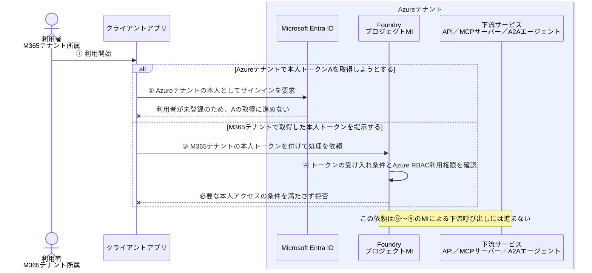

# クロステナントアプリ認証とMI-非ゲストユーザー

[ゲストユーザー版](クロステナントアプリ認証とMI-ゲストユーザー.md)と同じ配置で、M365テナントの利用者をAzureテナントに登録しない場合を説明する。

**以下の前提では、本人がFoundryを直接利用するところで成立しない。MIによる下流アクセスの問題とは別である。**

## 1. 今回の構成

| 対象 | 所属・配置先 |
| --- | --- |
| 利用者 | M365テナント。Azureテナントには利用者登録がない |
| FoundryとそのプロジェクトMI | Azureテナント |
| 下流サービス | Foundryと同じAzureテナント |

ここでは、次を前提とする。

- Foundryと下流サービスの認証先はAzureテナントとする。
- 「非ゲスト」は、ゲスト招待だけでなく、ほかの方法によるAzureテナントへの利用者登録も行わない状態を指す。
- 利用者本人のトークンでFoundryを直接呼び出し、Foundryは `AzureRbac`（`Entra`）方式で本人の利用権限を確認する。

```text
M365テナントの利用者
    ↓ Azureテナントには利用者登録・Foundry利用権限がない
AzureテナントのFoundry
    × 本人のアクセスが成立しない

AzureテナントのプロジェクトMI → Azureテナントの下流サービス
    この区間の権限付与は別に準備できるが、本人のアクセスは解決しない
```

この前提で成立しないことを、**「非ゲスト利用者は、どの認証方式・経路でもFoundryを使えない」という意味には広げない。**

## 2. 利用者のサインインとMIの認証は別

利用者はM365テナントのアカウントにサインインできる。しかし、それだけでは、Azureテナントの利用者としてFoundryを使えるようにはならない。

| トークン | 発行するテナント | この構成での扱い |
| --- | --- | --- |
| Foundry用の本人トークンA | Azureテナント | 利用者が未登録なので、Azureテナントの本人として取得する前提を満たさない |
| M365テナントで取得した本人トークン | M365テナント | Azureテナントの利用者登録やFoundryのAzure RBAC利用権限を代用しない |
| 下流用のMIトークンB | Azureテナント | MI自身の発行条件で取得する。本人の利用権限とは別 |

**MIに下流の権限を付けても、利用者のFoundry利用権限は付かない。**

## 3. サインインから処理結果までの流れ

ゲストユーザー版と同じ①〜⑨を使い、どこで先に進めなくなるかを示す。



M365へのサインイン、Azureテナントでの本人トークン取得、Foundryの利用許可は、同じことではない。

## 4. MIにはどの権限を付けるのか

MIへの権限付与は、ゲストユーザー版と同じである。例えば、Azureテナントの注文APIが次のアプリロールを定義しているとする。

```text
Orders.Read.AsApplication ＝ アプリ自身として注文情報を読む
```

権限を持つ管理者などが、このアプリロールをAzureテナントのプロジェクトMIに付与する。注文API側には、トークンの有効性と `roles` の値を確認し、注文情報を読む処理を許可する仕組みを実装・設定する。

**ここまで準備しても、②〜④で止まる本人の依頼が、⑤以降に進めるようになるわけではない。**

下流がAzure StorageならAzure RBACロールをMIに割り当てるなど、下流サービスの方式に従う点も変わらない。

## 5. 誰が何をするか

| 主体 | 何をするか・どこで止まるか |
| --- | --- |
| Azureテナントの利用者アクセスを管理する担当者 | この前提では本人を登録しないため、Azureテナントの本人としてFoundryを使う準備が整わない |
| Foundry側の開発者・管理者 | 下流接続やMIの認証方式は設定できるが、その設定で本人のアクセス条件を代用することはできない |
| （Azureテナントの下流API側の開発者・管理者） | APIの権限を定義し、トークン・権限の確認と業務処理を実装・設定する |
| 下流の権限付与を行う管理者 | プロジェクトMIに、第4章で説明した下流の権限を付与する |
| クライアントアプリ | ②Azureテナントの本人トークンAを取得できない。または③別テナントの本人トークンを提示しても、Foundryの利用条件を満たさない |
| Foundry | ③の呼び出しが来ても④のアクセス条件を満たさなければ拒否し、⑤以降の処理に進めない |
| AzureテナントのEntra ID | ②本人の登録・認証条件を確認する。MIの認証・トークン発行は本人とは別の処理 |
| 下流サービス | この本人の依頼からは⑦の呼び出しに到達しない |

ゲストユーザー版との違いは、**MIの下流アクセス権ではなく、本人がAzureテナントのFoundryを利用する準備の有無**である。

本人を登録せずに利用させたい場合は、M365の本人を認証する中間アプリが、Azure側のアプリやMIとしてFoundryを呼ぶなど、Foundryを呼ぶ主体・経路の設計を変える必要がある。これは、ゲストユーザー版から招待だけを省く構成とは別である。

## 公式資料

- [Azure RBAC：外部ユーザーへのロール割り当て](https://learn.microsoft.com/en-us/azure/role-based-access-control/role-assignments-external-users)
- [Foundry：エージェントエンドポイントの認可方式](https://learn.microsoft.com/en-us/azure/foundry/agents/concepts/agent-endpoint-authorization)
- [Foundry：Azure RBACによるエンドポイントアクセスの設定](https://learn.microsoft.com/en-us/azure/foundry/agents/how-to/configure-agent-endpoint-authorization#configure-azure-rbac-access)
- [Microsoft Entra ID：AzureリソースのマネージドID](https://learn.microsoft.com/en-us/entra/identity/managed-identities-azure-resources/overview)

関連：[ゲストユーザー版](クロステナントアプリ認証とMI-ゲストユーザー.md)、[アプリ認証／MIの基本](アプリ認証とMIの基本.md)、[構成と用語](Preview/構成と用語.md)。

次：[API：HTTP／OpenAPIの基本](Preview/API_HTTP_OpenAPIの基本.md)。
