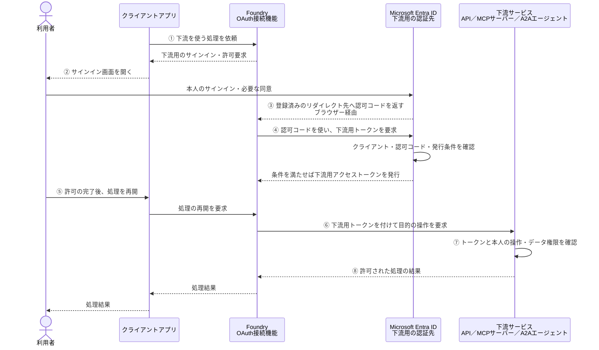

# 個別OAuthの基本

エージェントの入口認証とは別に、利用者が下流サービス用にサインインする方式を、Microsoft Entra IDを使う構成で説明する。

## 1. 個別OAuthとは

**個別OAuthは、利用者が下流サービス用に別のOAuthセッションを作り、そのサインインした本人の権限で下流サービスにアクセスする方式である。**

例えば、利用者がFoundryにサインインした後、注文APIを使うために、注文APIの認証先でもサインインする。

```text
本人OBO    ：「入口で認証した本人のトークンを根拠に、下流用のトークンを取得する」
個別OAuth ：「下流用に別途サインインして、下流用のトークンを取得する」
```

「個別OAuth」は本資料での呼び方であり、OAuth 2.0の独立したフロー名ではない。本書では、認可コードフローによる下流用の認証・許可を扱う。OBOもOAuth 2.0のフローの一つである。

**個別OAuthでも下流アクセスは本人の委任によるものであり、アプリ自身の権限でアクセスするアプリ認証とは異なる。**

## 2. トークン取得から処理結果までの流れ

下流用のOAuthセッションを作り、下流を呼び出す成功経路を示す。エージェントの入口認証は完了しているものとする。



③の認可コードは、下流サービスを呼び出すためのアクセストークンではない。④でトークンに交換する。**OBOのように入口の本人アクセストークンを `assertion` として交換する処理ではない。**

認可コードの交換には、クライアントの種類・構成に応じてPKCEやクライアント認証を使用する。シークレットが必要な構成では安全に保管し、プロンプトや公開ファイルには記載しない。

有効なセッションやトークンを再利用できる場合、毎回サインイン画面が表示されるとは限らない。更新トークンを取得・利用する構成では、再サインインせずにアクセストークンを更新できる場合もある。

## 3. スコープと同意は何を許可するのか

委任スコープは、**OAuthクライアントが本人の代理で「何をしてよいか」を表す権限**である。その名前と許可する操作は、下流APIの提供者が定義する。

例えば、注文APIが次のスコープを公開しているとする。

```text
orders.read ＝ 本人の代理で注文情報を読む
```

| 確認箇所 | 確認すること |
| --- | --- |
| OAuth接続の設定 | 注文API向けの委任スコープを要求する |
| 同意 | OAuthクライアントが本人の代理で、そのスコープを使うことを許可する |
| Entra IDのトークン発行 | サインインした本人、クライアント、要求スコープ、同意・ポリシーなどの発行条件を確認する |
| 注文APIの認証・認可 | トークンの署名・期限・発行元・宛先・本人・`scp` を検証し、本人に許可された注文だけを返す |

本人が同意できるか、管理者の同意が必要かは、要求する権限と組織のポリシーによって決まる。有効な同意が既にあれば、毎回同意する必要はない。

**管理者が同意しても、下流アクセスの本人が管理者に変わるわけではない。** 下流用OAuthでサインインした本人の代理アクセスとなる。

同意やスコープの設定だけでは、本人に注文データの閲覧権限は付かない。API側には、トークンを検証し、本人の操作・データへのアクセスを認可する仕組みを実装・設定する。

## 4. Foundryでは誰が何をするか

次は、Entra IDで保護された下流に、FoundryのカスタムOAuth接続を使う場合である。

| 主体 | 何をするか |
| --- | --- |
| Foundry側の開発者・管理者 | 下流用のOAuthクライアントをEntra IDにアプリ登録し、Foundryが指定するリダイレクトURIと必要な委任権限を設定する。接続に下流の接続先、認可・トークン・更新用URL、クライアント情報、要求スコープを設定する |
| （下流API側の開発者・管理者） | 下流APIをEntra IDにアプリ登録し、委任スコープ（例：`orders.read`）を公開する。API側でトークンを検証し、本人の操作・データへのアクセスを認可する |
| 利用者本人または権限を持つ管理者 | 必要な同意操作を行う |
| 利用者本人 | ②下流の認証先へサインインし、必要なMFA・許可操作を行う |
| クライアントアプリ | ②Foundryが返す許可要求を本人に提示し、⑤許可完了後に処理を再開する |
| Foundry | 下流用OAuthの状態を管理し、④トークンを取得して、⑥そのトークンを付けて下流を呼び出す |
| Entra ID | 本人を認証し、認可コード・トークンの発行条件を確認する |
| 下流サービス | ⑦トークンと本人の権限を確認し、⑧許可された処理の結果を返す |

Foundryの接続では `authType=OAuth2` を使う。MCPは `RemoteTool`、A2Aは `RemoteA2A` の接続を使用する。製品やツールが用意する管理されたOAuth構成を使う場合は、その設定方法に従う。

**接続を作るだけでなく、クライアントアプリが許可要求の表示と処理の再開に対応する必要がある。** 利用者・接続ごとのOAuth状態を分離し、他人のセッションやトークンを使い回さない。

Entra管理センターでアプリを登録すると、同じテナントに対応するエンタープライズ アプリケーション（サービスプリンシパル）も自動作成される。API等でアプリを作成する場合は、サービスプリンシパルの作成が別途必要になることがある。

## 5. OBO・アプリ認証との違い

| 比較すること | 本人OBO | 個別OAuth | アプリ認証／MI |
| --- | --- | --- | --- |
| 下流に対して誰としてアクセスするか | 入口で認証した本人の代理 | 下流用OAuthでサインインした本人の代理 | アプリやMI自身 |
| 下流用トークンの取得方法 | 入口の本人トークンを根拠にOBOで取得する | 下流用に別のOAuthセッションを作って取得する | アプリやMI自身を認証して取得する |
| 下流用の別サインイン | 入口トークンを利用する。必要な同意要求は別途発生し得る | 必要。有効なセッションがあれば画面操作を省略できる場合がある | 不要 |
| 下流で確認する権限 | 委任スコープと本人の操作・データ権限 | 委任スコープと下流用にサインインした本人の操作・データ権限 | アプリやMIに付与された権限 |

入口と下流に同じ人がサインインしていても、別のOAuthセッションで取得した下流トークンを使う場合は、入口トークンからのOBOではない。

## 6. 下流トークンの発行元と本人

Entra IDの個別OAuthでは、**下流用にサインインしたテナントが、下流トークンの発行元となる。Foundryの配置先テナントで決まるわけではない。**

例えば、次のように入口と下流用のサインインを分ける。

```text
入口       ：AzureテナントのFoundryにサインイン
下流用OAuth：M365テナントの本人として別途サインイン
下流トークン：M365テナント発行・下流リソース宛て
下流MCP    ：M365発行トークンを検証し、その本人の権限で処理
```

下流用の認証先、トークンの宛先、要求スコープ、OAuthクライアントの登録・同意を整合させる。FoundryとMCPのサーバーがどこに配置されているかとは分けて確認する。

入口と下流用OAuthで、別のアカウントを選ぶこともあり得る。**入口でサインインした本人と、下流で使われる本人を別々に確認する。** 同じ人でも、ゲストとしてサインインするテナントとホームテナントでは `tid`・`oid` が異なり得る。

## 7. エラーと成功の見方

- **サインイン・同意で停止**：認証先テナント、OAuthクライアント、リダイレクトURI、要求スコープ、本人のサインイン可否、MFA・同意ポリシーを確認する。
- **認可コード交換・更新で失敗**：トークンエンドポイント、クライアント認証、PKCE、コードや更新トークンの有効性を確認する。
- **下流の401・403**：トークンの発行元・宛先・期限・スコープと、下流での本人の操作・データ権限を確認する。
- **許可完了後もツールが動かない**：処理を再開したか、正しい利用者・接続のOAuth状態を使っているか、実ツールの完了・エラーを確認する。

**許可要求の取得やサインインの完了だけでは、下流処理の成功とは判定しない。** 実際のツール呼び出し、下流で検証された本人・宛先・スコープ、処理結果を照合する。生のトークン・認可コード・許可要求URLは公開証跡に残さない。

## 公式資料

- [Microsoft Entra ID：OAuth 2.0認可コードフロー](https://learn.microsoft.com/en-us/entra/identity-platform/v2-oauth2-auth-code-flow)
- [Microsoft Entra ID：権限と同意の概要](https://learn.microsoft.com/en-us/entra/identity-platform/permissions-consent-overview)
- [Foundry：ツールのユーザー委任設定・OAuth2](https://learn.microsoft.com/en-us/azure/foundry/agents/how-to/configure-user-delegation#configure-oauth2)
- [Foundry：MCPサーバーの認証設定・OAuth](https://learn.microsoft.com/en-us/azure/foundry/agents/how-to/mcp-authentication#oauth-identity-passthrough)

関連：[OBOの基本](OBOの基本.md)、[アプリ認証とMIの基本](アプリ認証とMIの基本.md)。製品別の設定要件は[認証方式ごとの成立条件](Preview/認証方式と成立条件.md)、実機結果は[検証結果統合マトリクス](検証結果統合マトリクス.md)を参照。
